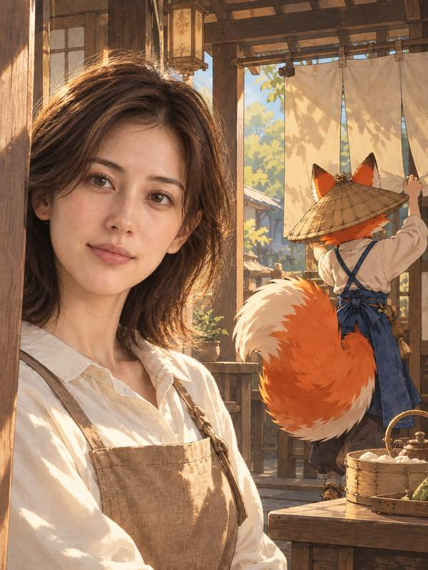
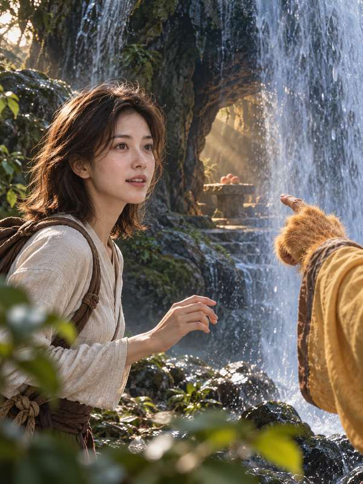
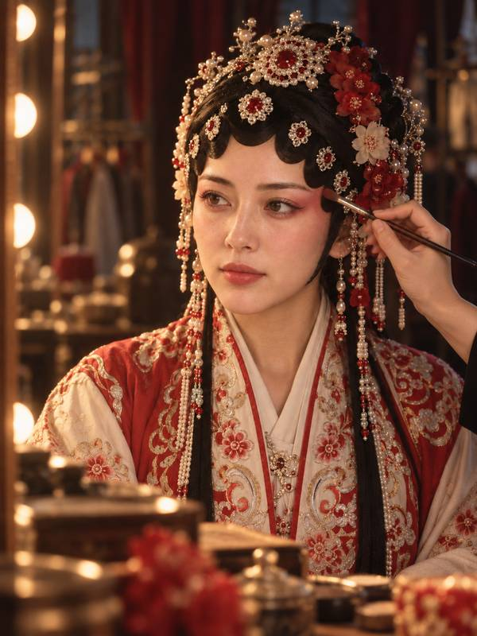
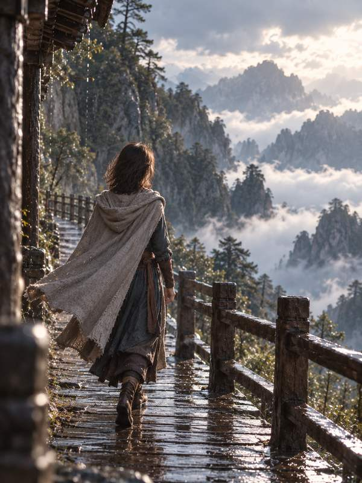
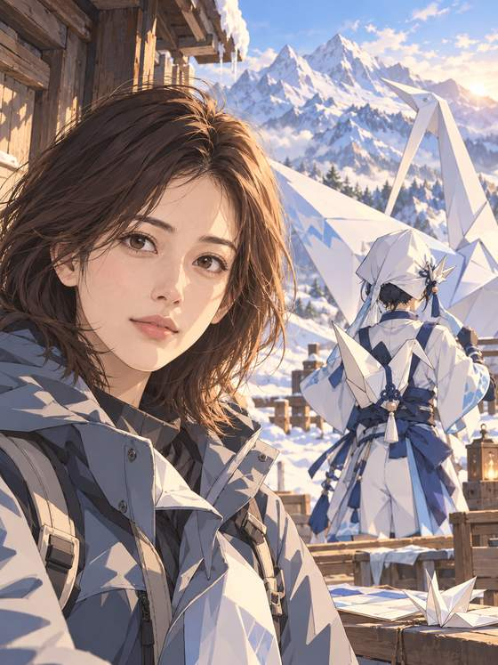
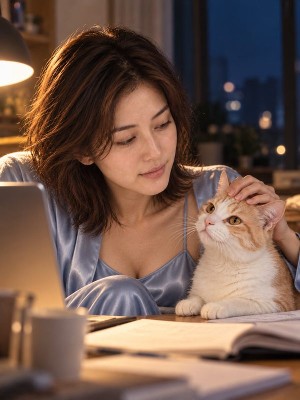

# shy-cameo · 入画

> This source package is the **1.0.2-rc.2 local update** with the tested `compile-edit` command. Install its companion plugin ZIP using the [installation guide](release/INSTALL.md). GitHub links to v1.0.2-rc.1 below refer to the previous public release; this update has not been published remotely.

**Turn your photo into a story you want to experience.**

A **Codex skill for AI story portraits**: start with one clear front-facing photo, plan a story, then generate five 3:4 portraits. Spend time with a character, try a costume, enter a film, travel, or enjoy everyday life with your pet. You are the lead; fictional companions appear through back views, hands and shadows.

[Get started](#get-started-in-three-steps) · [Case gallery](release/CASES.en.md) · [Capabilities](release/CAPABILITIES.en.md) · [Installation](release/INSTALL.md) · [简体中文](README.md)

> Public test release **[v1.0.2-rc.1](https://github.com/denggui-ai/shy-cameo-skill/releases/tag/v1.0.2-rc.1)** · Preview the storyboard first. Continue with another series, or revise one shot while keeping the previous version.

## Pick a story and see the results

These accepted examples feature an **AI-generated virtual adult**, not a real model. Click a cover for all five shots. They show possible results, not guaranteed consistency or proof of precise real-person identity or body control.

<p>
<a href="release/cases/virtual-fox-inn.md"></a>
<a href="release/cases/virtual-wukong-cave.md"></a>
<a href="release/cases/virtual-yuji-opera.md"></a>
<a href="release/cases/virtual-mulan.md"></a>
</p>

<p>
<a href="release/cases/virtual-wuxia.md"></a>
<a href="release/cases/virtual-paper-crane.md"></a>
<a href="release/cases/virtual-cappadocia.md"></a>
<a href="release/cases/virtual-cat-daily.md"></a>
</p>

[Fox Inn](release/cases/virtual-fox-inn.md) · [Water Curtain Cave](release/cases/virtual-wukong-cave.md) · [Yuji](release/cases/virtual-yuji-opera.md) · [Mulan](release/cases/virtual-mulan.md)<br>
[Wuxia](release/cases/virtual-wuxia.md) · [Animated adventure](release/cases/virtual-paper-crane.md) · [Night travel](release/cases/virtual-cappadocia.md) · [Life with a cat](release/cases/virtual-cat-daily.md)

**[Explore 11 virtual-model sets and 55 images →](release/CASES.en.md)** Also includes Athena in opera styling, The Painted Wall and A Trip to the Moon.

## Get started in three steps

You need **Codex and Python 3.9+**. Generating pictures also requires a Codex session with built-in image generation, a signed-in account and available quota. Installation does not generate images.

### 1. Install a fixed version

Open a Codex conversation and send:

```text
Use skill-installer to install skills/shy-cameo from
https://github.com/denggui-ai/shy-cameo-skill at tag v1.0.2-rc.1.
Install only; do not generate images. If shy-cameo is already installed,
check its location and version first.
```

**Start a new conversation after installation.** The current release passed direct skill installation, plugin ZIP installation and fresh-process discovery in isolated directories on macOS / Codex CLI 0.161.0. A first-use storyboard request also passed. Detailed [installation](release/INSTALL.md) and [validation](release/VALIDATION.md) guides are in Chinese; this does not cover a new physical machine, desktop clicks or upgrades.

### 2. Preview a storyboard

You can try the plan without uploading a photo yet:

```text
Use $shy-cameo to spend a day on set with Sun Wukong.
Show me a five-shot storyboard first. Do not generate images.
```

Review the scene, outfit and action for each shot. Change the theme, clothes or story before shooting. **This step makes no image-generation calls and uses no image-generation quota.**

### 3. Confirm and generate

Upload a clear front-facing photo of yourself or a consenting adult. Once you approve the plan, send:

```text
Generate this set. Do not retry failed calls.
```

A set uses at most five generation calls; failures may still use quota. Check the face, hands and body in each image. Ask to revise one shot or continue with another series. Previous versions are kept; a local revision can still change other details.

## Five categories, thirteen directions

| What you want | Example request | See the result |
|---|---|---|
| Character companionship | “Spend a day with a fox innkeeper” | [Fox Inn](release/cases/virtual-fox-inn.md), [Sun Wukong](release/cases/virtual-wukong-cave.md) |
| Costume portraits | “Try a Yuji opera look or Mulan-inspired armor” | [Yuji](release/cases/virtual-yuji-opera.md), [Mulan](release/cases/virtual-mulan.md) |
| Enter a story | “Step into The Painted Wall or a wuxia film” | [Painted Wall](release/cases/virtual-painted-wall.md), [Wuxia](release/cases/virtual-wuxia.md) |
| Travel on your own | “Plan a night in Cappadocia” | [Night travel](release/cases/virtual-cappadocia.md) |
| Everyday life with a pet | “Spend a quiet evening with my cat” | [Life with a cat](release/cases/virtual-cat-daily.md) |

Try photographic, fully animated or photographic-subject/animated-world styles. Adjust clothes, lighting, camera framing and actions. See [capabilities and evidence](release/CAPABILITIES.en.md) for the thirteen directions and remaining experimental scope.

## Before you use it

- **Likeness has limits.** Head turns, large movements and full-body wide shots can cause face drift. Hands can be drawn incorrectly.
- **Body guidance follows available evidence.** Use a body photo, a headshot with your description, or explicit local adjustment requests. Three full-body views are not required. The optional gallery is a communication aid; precise body or bust control and consistency across outfits, side views and back views remain unverified.
- **Photos are sent to the image service.** This project does not collect photos and is not fully offline. Upload only photos of yourself or consenting adults. Explain the intended use and obtain separate consent before using someone else's photo.
- **Publication and commercial use involve rights.** You are responsible for uploaded and generated content. Commercial use depends on the image service's terms and the rights in the characters involved; obtain the necessary authorization yourself.

## Feedback and contributions

For questions or suggestions, open an [issue](https://github.com/denggui-ai/shy-cameo-skill/issues) with your environment and steps to reproduce. **Do not post private photos or personal information.** For copyright, likeness, security or privacy concerns, follow [SECURITY.md](SECURITY.md).

[Verification matrix (中文)](release/VERIFICATION-MATRIX.md) · [Test plan (中文)](release/NEXT-TESTS.md) · [Validation scope](release/VALIDATION.md) · [Development](release/DEVELOPMENT.md) · [Changelog](CHANGELOG.md) · [Contributing](CONTRIBUTING.md)

The [MIT license](LICENSE) covers the software, not other uses of anyone's likeness. Images are AI-generated. This project is not affiliated with any featured work's rights holders or with Cameo. Rights statements are not legal advice. Formerly named classic-coshoot.
