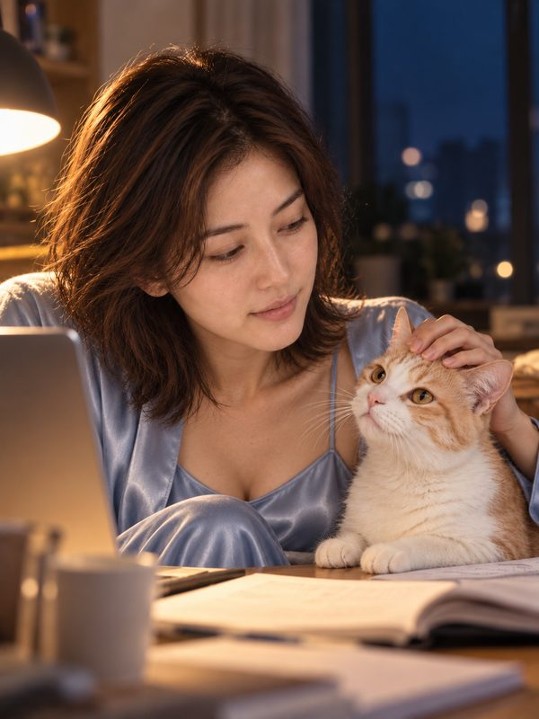
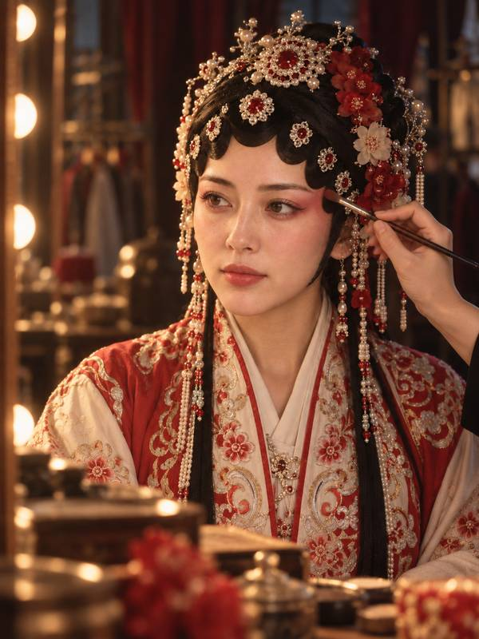
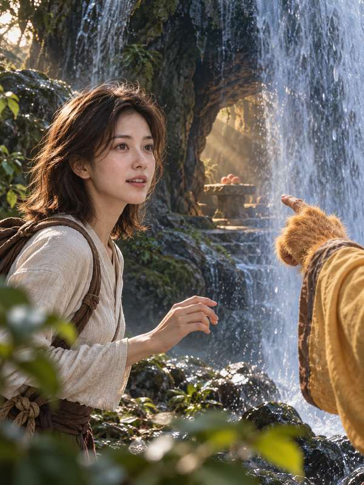
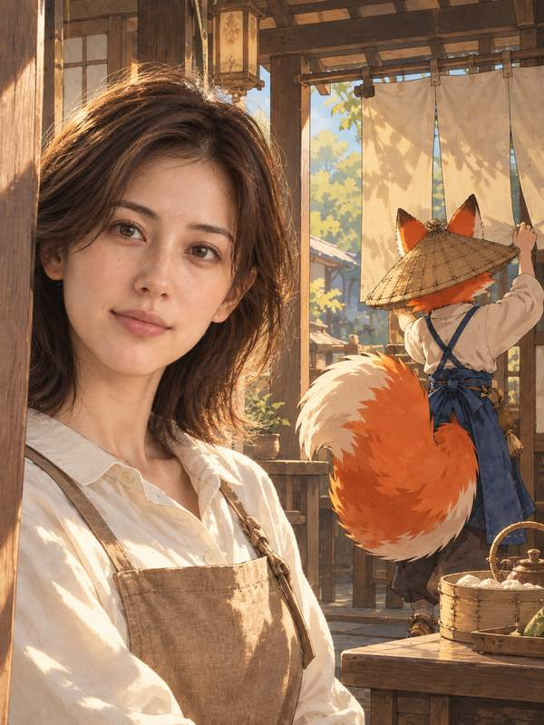
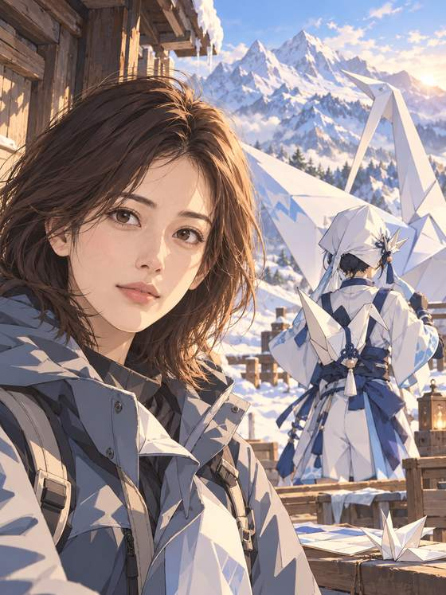
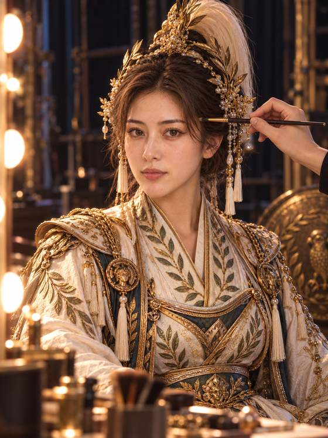
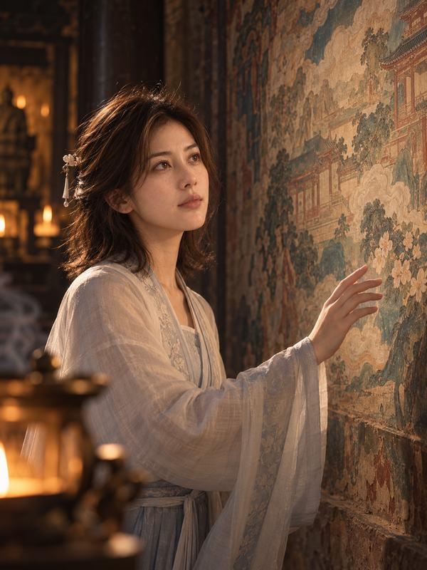
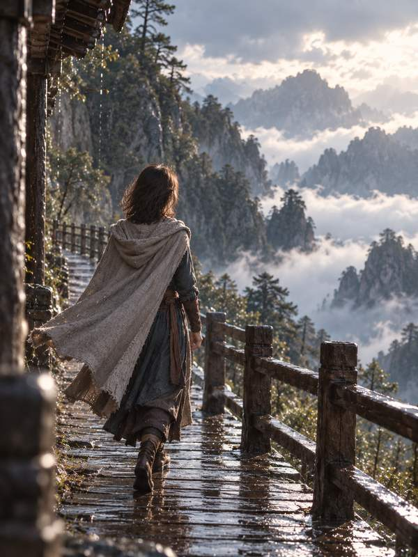
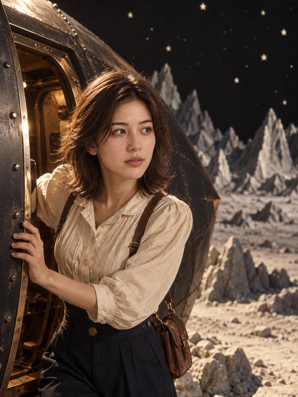
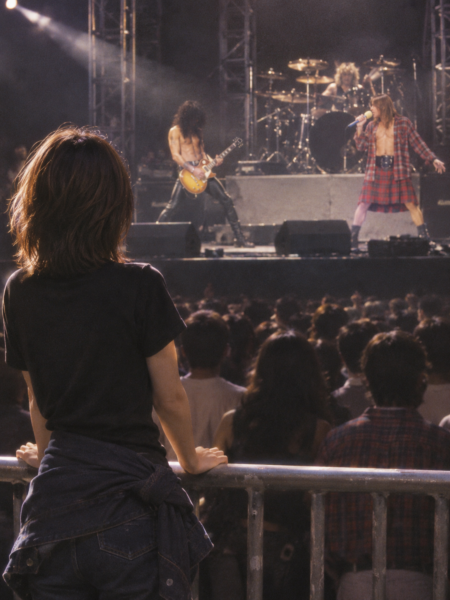

# shy-cameo · 入画

**[Explore the showcase and see what the skill can do →](https://denggui-ai.github.io/shy-cameo-skill/site/)**


**English** · [简体中文](README.zh-CN.md)

**Turn your photo into a story you want to experience.**

A **Codex skill for AI story portraits**: turn one clear front-facing photo into **a set of five 3:4 portraits**. Preview the storyboard, then decide whether to generate it.

Spend time with a character, try a costume, enter a film, travel, or enjoy everyday life with your pet. This release also includes your own concert, band interactions and a night in the audience. You are the lead; fictional companions appear through back views, hands and shadows.

[Get started](#get-started-in-three-steps) · [Case gallery](release/CASES.en.md) · [Capabilities](release/CAPABILITIES.en.md) · [Installation](release/INSTALL.md) · [Limitations](#before-you-use-it)

> Five images tell one story. Continue with another set or revise a single shot while keeping previous versions. The current version is [v1.1.0](https://github.com/denggui-ai/shy-cameo-skill/releases/tag/v1.1.0); review each generated image.

## Pick a story and see the results

**13 selected photo stories, 65 images.** Open a cover for the images, a starter prompt and production notes.

All examples below feature an **AI-generated virtual adult protagonist** and have owner authorization for public display; each case records its actual feedback and review status. They show possible results, not guaranteed consistency or proof of precise real-person identity or body control.

<p>
<a href="release/cases/virtual-cat-daily.md"></a>
<a href="release/cases/virtual-yuji-opera.md"></a>
<a href="release/cases/virtual-wukong-cave.md"></a>
<a href="release/cases/virtual-fox-inn.md"></a>
</p>

[Life with a cat](release/cases/virtual-cat-daily.md) · [Yuji](release/cases/virtual-yuji-opera.md) · [Sun Wukong](release/cases/virtual-wukong-cave.md) · [Fox Inn](release/cases/virtual-fox-inn.md)

<p>
<a href="release/cases/virtual-paper-crane.md"></a>
<a href="release/cases/virtual-athena-opera.md"></a>
<a href="release/cases/virtual-mulan.md"></a>
<a href="release/cases/virtual-painted-wall.md"></a>
</p>

[Zhiyuan's animated adventure](release/cases/virtual-paper-crane.md) · [Athena](release/cases/virtual-athena-opera.md) · [Mulan](release/cases/virtual-mulan.md) · [The Painted Wall](release/cases/virtual-painted-wall.md)

<p>
<a href="release/cases/virtual-wuxia.md"></a>
<a href="release/cases/virtual-cappadocia.md"></a>
<a href="release/cases/virtual-moon-film.md"></a>
<a href="release/cases/virtual-gnr-tokyo.md"></a>
</p>

[Wuxia](release/cases/virtual-wuxia.md) · [A Night in Cappadocia](release/cases/virtual-cappadocia.md) · [A Trip to the Moon](release/cases/virtual-moon-film.md) · [Tokyo concert story](release/cases/virtual-gnr-tokyo.md)

<p>
<a href="release/cases/virtual-last-chord.md"></a>
</p>

[The Last Chord](release/cases/virtual-last-chord.md)

**[Browse the complete gallery and all 65 images →](release/CASES.en.md)**

## Get started in three steps

| What to prepare | Requirements |
|---|---|
| Environment | Codex; scripts run on macOS / Linux with Python 3.9+ |
| Storyboard preview | You can start without a photo; this step makes no image-generation calls |
| Image generation | A Codex session with built-in image generation, a signed-in account and available quota; a clear front-facing photo of yourself or a consenting adult |

Installation evidence comes from macOS / Codex CLI 0.161.0; it does not cover Windows or other clients. See [installation](release/INSTALL.md) for optional face detection, the body-reference gallery and other hosts. **Installation does not generate images.**

### 1. Install a fixed version

Open a Codex conversation and send:

```text
Use skill-installer to install skills/shy-cameo from
https://github.com/denggui-ai/shy-cameo-skill at tag v1.1.0.
Install only; do not generate images. If shy-cameo is already installed,
check its location and version first.
```

**Start a new conversation after installation, then continue to step 2.** If the skill or plugin is already installed, follow the [installation guide](release/INSTALL.md) to check it and keep only one installation active. The guide also covers verification, upgrades, rollback and the plugin ZIP option.

### 2. Preview a storyboard

You can try the plan without uploading a photo yet:

```text
Use $shy-cameo to spend a day on set with Sun Wukong.
Show me a five-shot storyboard first. Do not generate images.
```

Review the scene, outfit and action for each shot. Change the theme, clothes or story before shooting. **This step makes no image-generation calls and uses no image-generation quota.**

### 3. Confirm and generate

Upload a clear front-facing photo of yourself or a consenting adult. Once you approve the plan, send:

```text
Generate this set. Do not retry failed calls.
```

A set uses at most five generation calls; failures may still use quota. If the first shot fails, the set stops. Later failed shots are not automatically retried. Timeouts and unknown results must be checked before deciding whether to continue. Review the face, hands and body in each image.

Ask to revise one shot or continue with another series. Previous versions are kept. Revisions use new generation calls, and a local revision can still change other details. See the [release notes](release/RELEASE-NOTES.md) for verified scope and remaining limitations.

## Seven categories, fifteen directions

| What you want | Example request | See the result |
|---|---|---|
| Character companionship | “Spend a day with a fox innkeeper” | [Fox Inn](release/cases/virtual-fox-inn.md), [Sun Wukong](release/cases/virtual-wukong-cave.md) |
| Costume portraits | “Try a Yuji opera look or Mulan-inspired armor” | [Yuji](release/cases/virtual-yuji-opera.md), [Mulan](release/cases/virtual-mulan.md) |
| Enter a story | “Step into The Painted Wall or a wuxia film” | [Painted Wall](release/cases/virtual-painted-wall.md), [Wuxia](release/cases/virtual-wuxia.md) |
| Travel on your own | “Plan a night in Cappadocia” | [Night travel](release/cases/virtual-cappadocia.md) |
| Everyday life with a pet | “Spend a quiet evening with my cat” | [Life with a cat](release/cases/virtual-cat-daily.md) |
| My stage | “Make me a guitarist at a wild rock concert” | [My Stage: Electric Guitar](release/cases/virtual-my-stage-guitar.md) |
| Attend their concert | “Take me to a Queen or Jay Chou concert” | [Tokyo 1992 audience story](release/cases/virtual-gnr-tokyo.md) |

The two experimental concert directions are included in **v1.1.0**. Explore [performing on stage](release/cases/virtual-last-chord.md) and [attending a concert](release/cases/virtual-gnr-tokyo.md).

Try photographic, fully animated or photographic-subject/animated-world styles. Adjust clothes, lighting, camera framing and actions. See [capabilities and evidence](release/CAPABILITIES.en.md) for all fifteen directions and remaining experimental scope.

## Before you use it

- **Likeness has limits.** Head turns, large movements and full-body wide shots can cause face drift. Hands can be drawn incorrectly.
- **Body guidance follows available evidence.** Use a body photo, a headshot with your description, or explicit local adjustment requests. Three full-body views are not required. The optional gallery is a communication aid; precise body or bust control and consistency across outfits, side views and back views remain unverified.
- **Photos are sent to the image service.** This project does not collect photos and is not fully offline. Upload only photos of yourself or consenting adults. Explain the intended use and obtain separate consent before using someone else's photo.
- **Publication and commercial use involve rights.** You are responsible for uploaded and generated content. Commercial use depends on the image service's terms and the rights in the characters involved; obtain the necessary authorization yourself.

## Feedback and contributions

For questions or suggestions, open an [issue](https://github.com/denggui-ai/shy-cameo-skill/issues) with your environment and steps to reproduce. **Do not post private photos or personal information.** For copyright, likeness, security or privacy concerns, follow [SECURITY.md](SECURITY.md).

[Development and verification](release/dev/README.md) · [Changelog](CHANGELOG.md) · [Contributing](CONTRIBUTING.md)

The [MIT license](LICENSE) covers the software, not other uses of anyone's likeness. Images are AI-generated. This project is not affiliated with any featured work's rights holders or with Cameo. Rights statements are not legal advice. Formerly named classic-coshoot.
