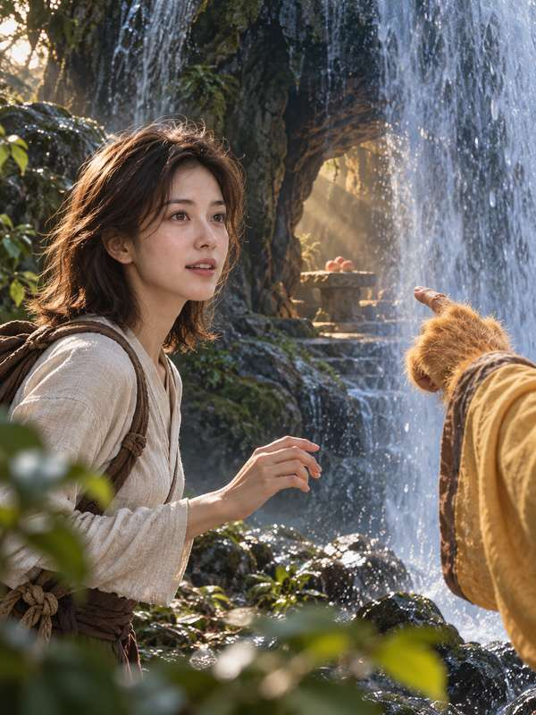
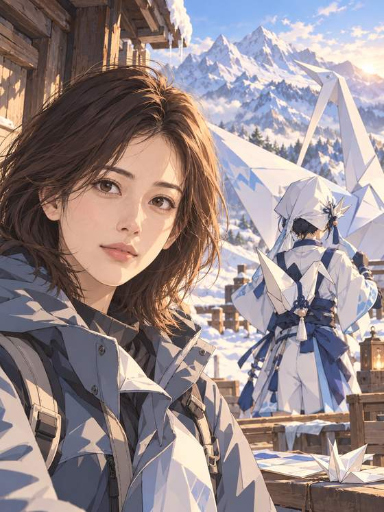
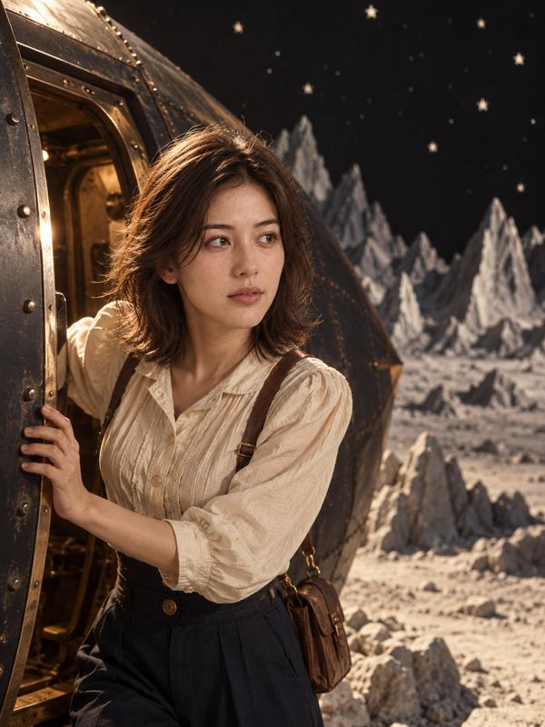
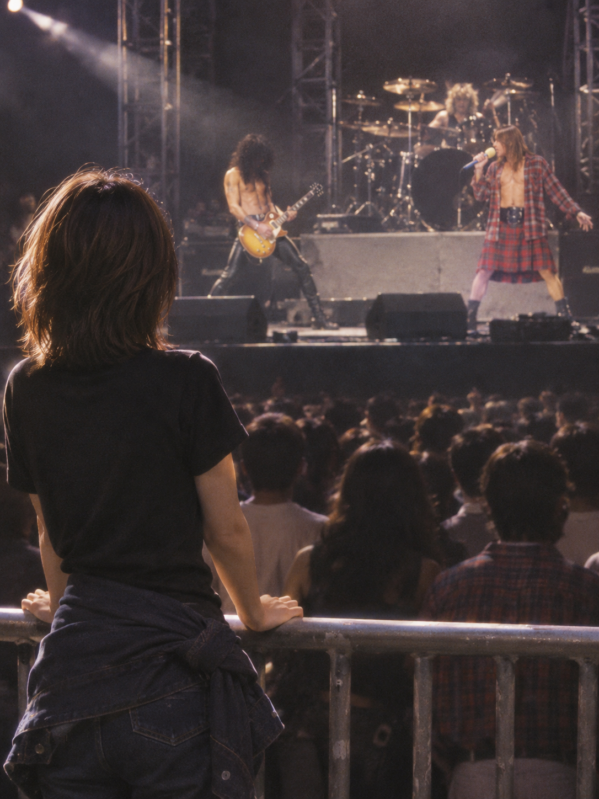

# 入画 · shy-cameo

[English](README.md) · **简体中文**

**用你的照片，走进想经历的故事。**

入画是一个 **Codex AI 故事写真技能（skill）**：用一张清楚的正脸照，策划并生成**一套五张 3:4 竖图**。先看分镜，满意后再开拍。

和喜欢的角色同框、换上戏服、走进电影、独自旅行，或记录与宠物相处的日常。本版也包含自己开演唱会、与乐队互动，以及去听 TA 演唱会。你是主角；陪同角色有点害羞，用背影、手和影子入镜。

[开始使用](#三步开始) · [完整案例集](release/CASES.md) · [7 类玩法](release/CAPABILITIES.md) · [安装指南](release/INSTALL.md) · [使用限制](#使用前了解这些)

> 五张连成一个故事；拍完可以继续下一套，也可以只改某一张并保留旧版。当前为 [v1.1.0-rc.1 预发布版](https://github.com/denggui-ai/shy-cameo-skill/releases/tag/v1.1.0-rc.1)，成片需要逐张检查。

## 选一个故事，看看效果

**14组五张故事图＋3张互动补充，共73张。** 点击封面查看成片、开场请求与制作说明。

以下均以 **AI 虚拟成年模特**为主角，公开展示已获作者授权，各页分别记录实际反馈与验收范围。它们展示可能的效果，不保证每次一致，也不等于真人锁脸或精确身材控制验证。

<p>
<a href="release/cases/virtual-cat-daily.md"></a>
<a href="release/cases/virtual-yuji-opera.md"></a>
<a href="release/cases/virtual-wukong-cave.md"></a>
<a href="release/cases/virtual-fox-inn.md"></a>
</p>

[和猫的安静夜晚](release/cases/virtual-cat-daily.md) · [虞姬](release/cases/virtual-yuji-opera.md) · [孙悟空与水帘洞](release/cases/virtual-wukong-cave.md) · [狐狸客栈](release/cases/virtual-fox-inn.md)

<p>
<a href="release/cases/virtual-paper-crane.md"></a>
<a href="release/cases/virtual-athena-opera.md"></a>
<a href="release/cases/virtual-mulan.md"></a>
<a href="release/cases/virtual-painted-wall.md"></a>
</p>

[纸鸢的动画冒险](release/cases/virtual-paper-crane.md) · [雅典娜](release/cases/virtual-athena-opera.md) · [木兰](release/cases/virtual-mulan.md) · [画壁](release/cases/virtual-painted-wall.md)

<p>
<a href="release/cases/virtual-wuxia.md"></a>
<a href="release/cases/virtual-cappadocia.md"></a>
<a href="release/cases/virtual-moon-film.md"></a>
<a href="release/cases/virtual-gnr-tokyo.md"></a>
</p>

[武侠交锋](release/cases/virtual-wuxia.md) · [卡帕多奇亚的夜色](release/cases/virtual-cappadocia.md) · [月球旅行记](release/cases/virtual-moon-film.md) · [东京观演故事](release/cases/virtual-gnr-tokyo.md)

<p>
<a href="release/cases/virtual-my-stage-guitar.md"></a>
<a href="release/cases/virtual-last-chord.md"></a>
</p>

[我的舞台：电吉他手](release/cases/virtual-my-stage-guitar.md) · [最后一个和弦：五张重制](release/cases/virtual-last-chord.md)

**[浏览完整案例集与 73 张成片 →](release/CASES.md)**

## 三步开始

| 先准备什么 | 要求 |
|---|---|
| 使用环境 | Codex；脚本运行于 macOS / Linux，需要 Python 3.9+ |
| 先看分镜 | 可以先不上传照片；这一步不调用生图 |
| 确认开拍 | 当前 Codex 会话支持内置生图，账号已登录且有可用额度；准备本人或已获同意的成年人的清楚正脸照 |

安装验证来自 macOS / Codex CLI 0.161.0；Windows 与其他客户端未由此验证。可选人脸检测、身形图库和其他宿主说明见[安装指南](release/INSTALL.md)。**安装本身不生成图片。**

### 1. 安装固定版本

在 Codex 新建对话，复制发送：

```text
请使用 skill-installer，从 https://github.com/denggui-ai/shy-cameo-skill
安装 skills/shy-cameo 目录，版本固定为 v1.1.0-rc.1。
只安装，不生图。已有同名安装时先核对位置与版本。
```

安装完成后**新开对话，再进行第 2 步**。已有同名技能或插件时，先按[安装指南](release/INSTALL.md)核对，只保留一种生效的安装方式；校验、升级、回退与插件 ZIP 安装也在该指南中。

### 2. 先试一套分镜

可以先不上传照片，直接发送：

```text
用 $shy-cameo 和孙悟空在剧组待一天。
先给我看五张分镜，不要生图。
```

你会看到五张照片的场景、衣装和动作方案。可以改主题、换衣服或调整情节。**这一步不调用生图，也不消耗生图额度。**

### 3. 确认后再拍

上传一张本人或已获同意的成年人的清楚正脸照，确认分镜后发送：

```text
按这套拍，失败不重试。
```

一套最多五次生图调用，失败也可能消耗额度。首张失败会停止本套，后续单张失败不自动重试；超时或结果不明时先核对，再决定是否继续。拍完逐张检查人脸、手和身形。

想调整时可以说“只改第 3 张的动作”，也可以继续拍下一个系列；旧版保留。修订会产生新的生图调用，局部修改仍可能影响其他细节。已验证范围与剩余限制见[发布说明](release/RELEASE-NOTES.md)。

## 7 类玩法，15 种方向

| 想拍什么 | 可以这样说 | 看案例 |
|---|---|---|
| 和角色同框 | “和狐狸掌柜过一天”／“去花果山找孙悟空” | [狐狸客栈](release/cases/virtual-fox-inn.md)、[水帘洞](release/cases/virtual-wukong-cave.md) |
| 扮成一个人 | “穿虞姬的戏曲扮相”／“试穿木兰主题盔甲” | [虞姬](release/cases/virtual-yuji-opera.md)、[木兰](release/cases/virtual-mulan.md) |
| 走进一个故事 | “走进《画壁》”／“拍一部武侠片” | [画壁](release/cases/virtual-painted-wall.md)、[武侠](release/cases/virtual-wuxia.md) |
| 自己去旅行 | “拍一套卡帕多奇亚夜景旅行写真” | [夜景旅行](release/cases/virtual-cappadocia.md) |
| 和宠物过日常 | “和我的猫度过一个安静的夜晚” | [猫的陪伴](release/cases/virtual-cat-daily.md) |
| 我的舞台 | “我当吉他手，拍一场疯狂的摇滚现场” | [我的舞台：电吉他手](release/cases/virtual-my-stage-guitar.md) |
| 去听 TA 的演唱会 | “去听周杰伦／五月天的演唱会” | [东京1992观演故事](release/cases/virtual-gnr-tokyo.md) |

两种演唱会玩法及乐队互动已纳入 **v1.1.0-rc.1 安装包，仍属试验功能**。东京观演五张已获正向反馈；电吉他手五张已获整套认可。我的舞台可规划与原创成年队友合奏、回应和共同谢幕，[三张互动补充](release/cases/virtual-my-stage-guitar.md#队友互动补充--band-interaction-supplement)已获选用，谢幕采用按用户要求修正后的版本。[《最后一个和弦》现为五张重制版](release/cases/virtual-last-chord.md)，按作者指出旧图问题后的要求重新生成；旧四张及旧第五张待核记录保留为历史版本。重制采用开发源码新增的乐器连续性指导，固定安装包尚未更新。可按艺人和年代规划门票、场刊及应援物，新版物料指导尚未完成对应实拍。具体范围见[演唱会玩法](release/CAPABILITIES.md#演唱会玩法试验)。

支持摄影感、全动画和摄影人物＋动画环境，也可调整衣装、光线、机位与动作。可用玩法、已有案例和仍需试验的范围分别列在[能力清单](release/CAPABILITIES.md)。

## 使用前了解这些

- **相似度有局限。** 转头、大动作和全身远景可能让人脸漂移，手也可能画错。
- **身形按已有依据描述。** 支持身体照片、只有头像时的自述，以及明确的局部调整要求；不强制提供全身三视图。可选图库只是沟通示例，精准身材／胸型控制及换装、侧身、背影的一致性尚未验证。
- **照片会交给生图服务处理。** 本项目不收集照片，也不是全程离线工具。只上传本人或已获同意的成年人的照片；使用他人照片前，应说明用途并取得对方单独同意。
- **公开与商用需留意权利。** 你对上传和生成的内容负责；商用取决于生图服务条款及所涉角色的权利，须自行取得相应授权。

## 反馈与参与

使用问题或建议请到 [Issues](https://github.com/denggui-ai/shy-cameo-skill/issues)，附上使用环境和复现步骤，**不要公开上传私人照片或个人信息**。版权、肖像权、安全与隐私问题请按 [SECURITY.md](SECURITY.md) 联系。

[开发与验证文档](release/dev/README.md) · [变更记录](CHANGELOG.md) · [贡献说明](CONTRIBUTING.md)

[MIT 许可](LICENSE) 适用于软件，不包含肖像的其他使用授权。成片由 AI 生成，本项目与作品权利方及 Cameo 无关联。权利说明不是法律意见。本项目原名 classic-coshoot。
