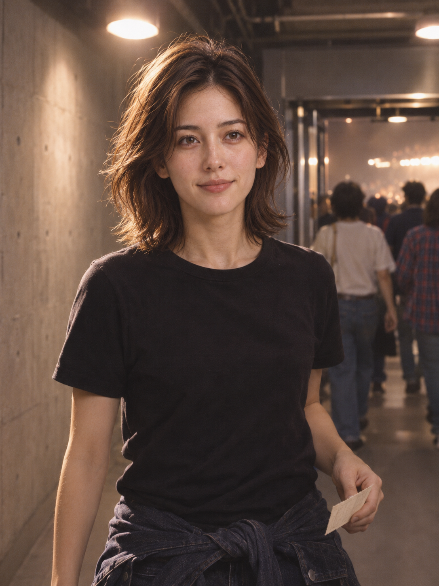
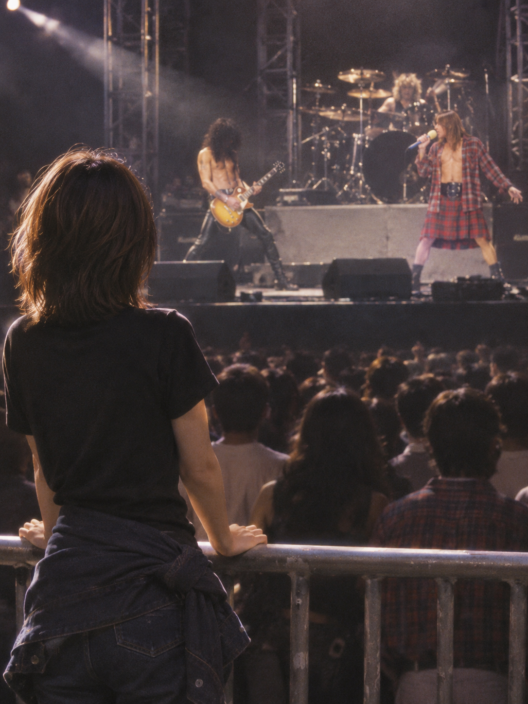
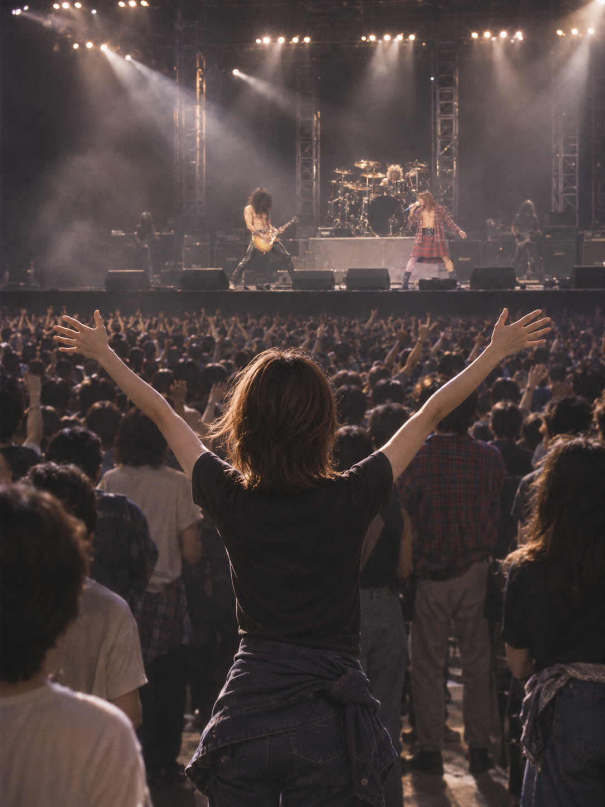
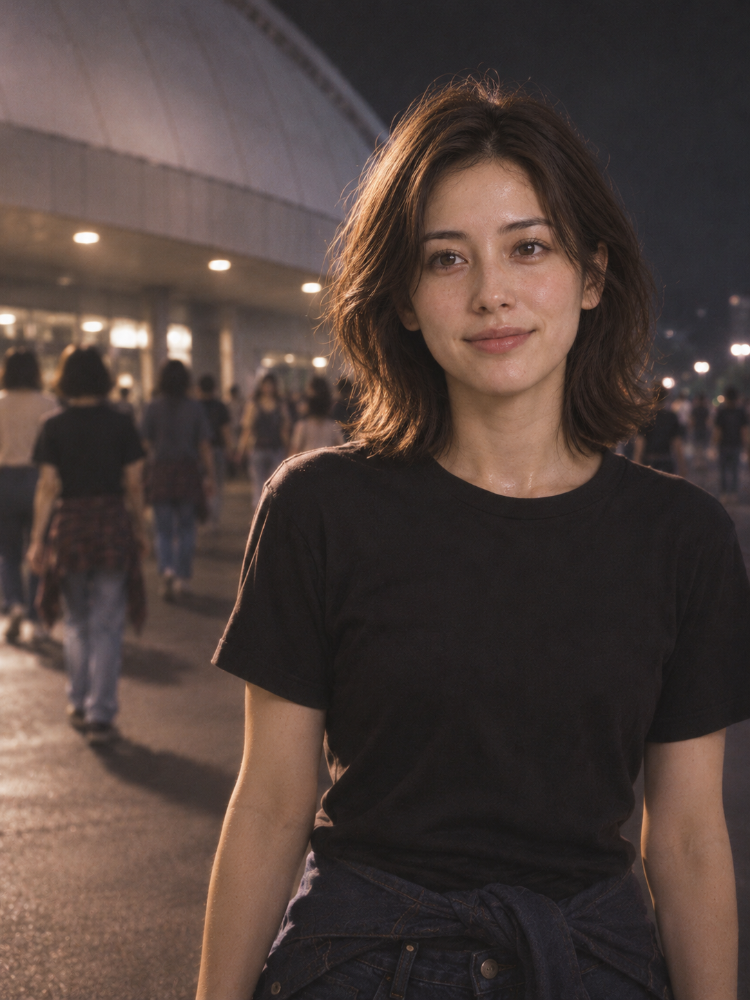

# 东京1992：我的观演故事 · Tokyo 1992: My Night in the Audience

[全部案例 / All cases](../CASES.md) · [English index](../CASES.en.md) · [开始使用 / Get started](../../README.md)

**AI 生成 · 主角为原创虚拟成年人，远处舞台为 Guns N’ Roses 1992 Tokyo Dome 主题的想象演出。** 不是主角实际到场的记录，也不是官方合作。没有传入真实艺人照片。

**AI-generated.** An original virtual adult experiences an imagined Guns N’ Roses performance inspired by Tokyo Dome in 1992. This is not evidence of real attendance or an official collaboration. No artist photograph was supplied.

开发版试验玩法，尚未包含在 **v1.0.3-rc.1**。 / Experimental development-source feature, **not included in v1.0.3-rc.1**.

## 五张成片 / Five-shot set

入场期待 → 看见舞台 → 身在现场 → 全场高潮 → 散场余韵。舞台核心先生成，交付按故事顺序展示。

Arrival → seeing the stage → a personal detail → the chorus → departure. The core stage image was generated first; the gallery follows story order.

<p>
<a href="../../assets/showcase/virtual-gnr-tokyo/01.png"></a>
<a href="../../assets/showcase/virtual-gnr-tokyo/02.png"></a>
<a href="../../assets/showcase/virtual-gnr-tokyo/03.png"></a>
<a href="../../assets/showcase/virtual-gnr-tokyo/04.png"></a>
<a href="../../assets/showcase/virtual-gnr-tokyo/05.png"></a>
</p>

## 可以这样开始 / Try this

```text
想象我去听枪炮与玫瑰1992年东京巨蛋演唱会，用五张表现入场、看舞台、个人细节、高潮和散场。先给分镜，不生图。
```

```text
Imagine me attending Guns N’ Roses at Tokyo Dome in 1992. Plan a five-shot audience story with arrival, the stage, a personal detail, the peak and departure. Do not generate images yet.
```

## 选用版本与范围 / Selection and scope

作者反馈：“这套我觉得还不错”，随后要求同步案例与能力清单。本页记录整套的正向评价及展示选择，没有代填正式 CLI 的逐张验收。5次调用得到5张，0重试；使用原编译器和内置生图，按原创虚拟主体调整素材来源措辞，不是正式真人 CLI 全流程。

The owner gave positive feedback on the set and requested its inclusion in the case documentation. This records overall feedback and gallery selection, not formal per-image CLI verdicts. Five calls returned five images without retries, using native generation and compiler guidance adapted for the virtual subject.

入场与散场构图较接近；远景舞台造型可见，但不证明艺人辨识、历史细节或乐器结构准确。后来补充的门票、场刊、应援物取得与收纳指导尚未在这套里完整实拍，不能用它代替新版物料效果验证。

Arrival and departure use similar frontal framing. Visible stage styling does not establish reliable performer recognition, exact historical reconstruction or instrument anatomy. The later ticket, programme and merchandise continuity guidance has not been tested by this set.

此处保留原字节 PNG 与原有 AI 来源标识；没有为网页展示重新生图或重编码。 / These are byte-identical PNG copies retaining the original AI provenance; no extra generation or re-encoding was used for the gallery.

[图片摘要 / Image manifest](../../assets/showcase/virtual-gnr-tokyo/manifest.json) · [能力与限制 / Capabilities](../CAPABILITIES.en.md)
