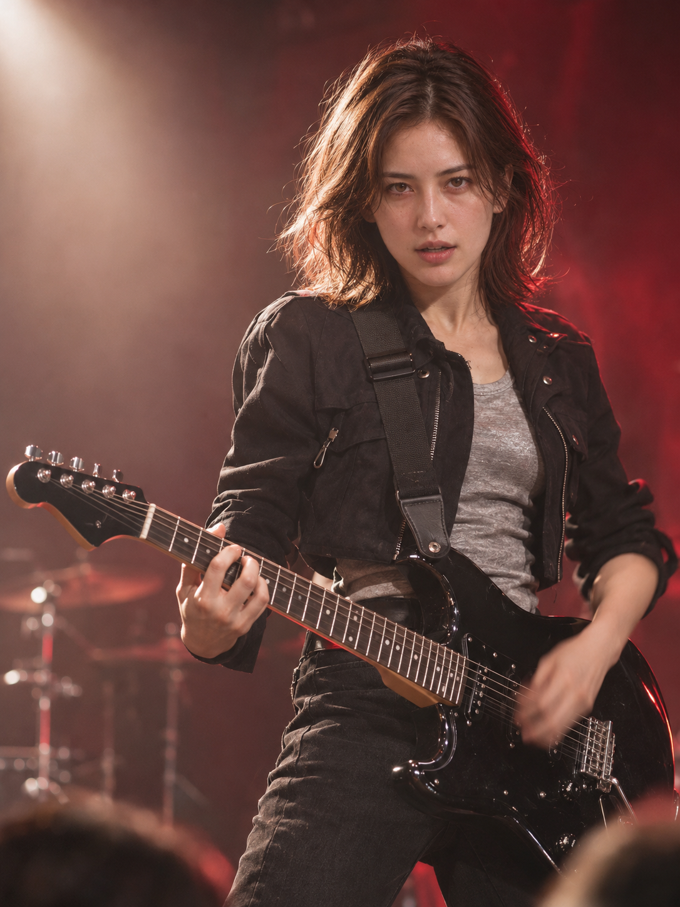
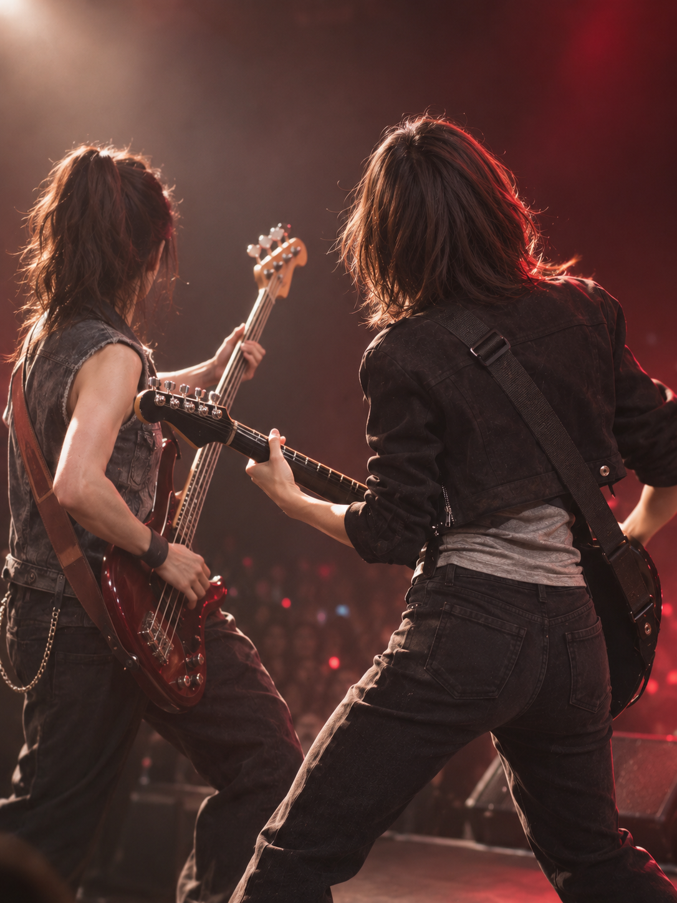
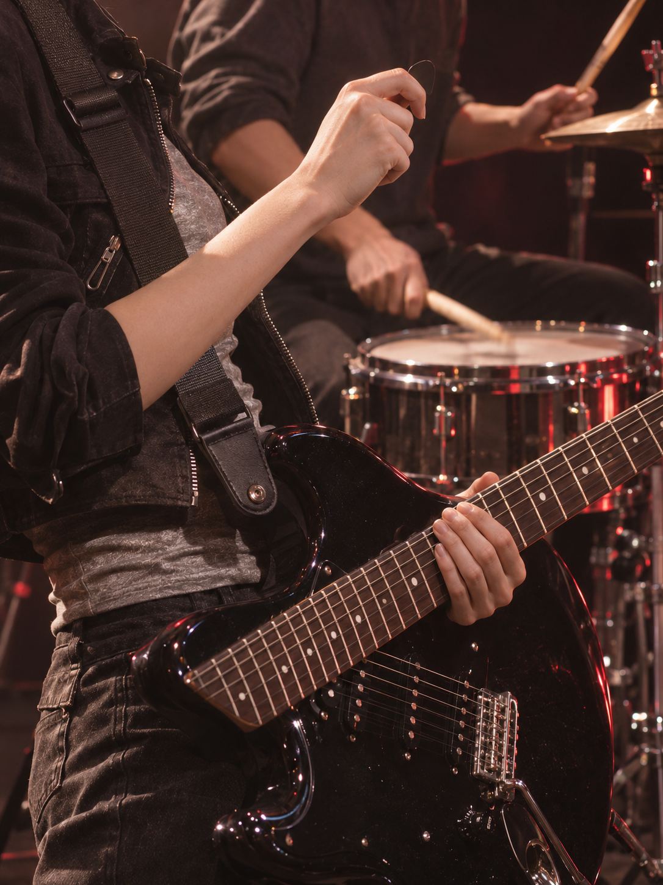

# 最后一个和弦 · 旧问题版本 / Historical version

> 本页保留被替换的旧四张及当时反馈。作者随后指出错误较多并要求重拍；这四张已退出当前图库计数。[查看五张重制版](virtual-last-chord.md)。
> These four images are preserved as the superseded version. The owner later requested a full remake; they are excluded from the current gallery count. [View the five-shot remake](virtual-last-chord.md).

[全部案例 / All cases](../CASES.md) · [English index](../CASES.en.md) · [开始使用 / Get started](../../README.md)

**四张摇滚现场选集 · AI 生成 · 原创虚拟成年人物。** 从开场的第一记重拍，到与贝斯手合奏、向鼓手给出信号，再进入个人独奏。黑色夹克、银灰上衣和红色舞台光串起这四个瞬间。

**A four-image rock selection · AI-generated · Original virtual adult subject.** An opening downbeat, a duet with the bassist, a cue to the drummer and a solo peak. A black jacket, silver-grey top and red stage lighting connect the four moments.

## 四张成片 / The four images

### ① 第一记重拍 / The opening downbeat

<a href="../../assets/showcase/virtual-last-chord/01-opening.png"></a>

### ② 与贝斯手合拍 / In time with the bassist

<a href="../../assets/showcase/virtual-last-chord/02-bass-duet.png"></a>

### ③ 把下一拍交给鼓手 / Cueing the drummer

<a href="../../assets/showcase/virtual-last-chord/03-drummer-cue.png"></a>

### ④ 独奏爆发 / The solo peak

<a href="../../assets/showcase/virtual-last-chord/04-solo-peak.png"></a>

## 作者反馈与收录范围 / Owner feedback and selection

作者在看到四张成片及已指出的问题后反馈：“我觉得这个效果不错的 可以考虑作为正式案例”。本页据此收录四张选集，保留原图与观察记录。作者认可的是这四张作品的整体效果；下面分别说明制作范围与已观察到的限制。

After seeing the four outputs and the disclosed issues, the owner gave positive feedback and favored inclusion as an official case. These four images are therefore selected for the gallery, with their original files and limitations retained. Overall approval does not mean that every detail is correct.

原计划为五张，本轮5次调用返回4张，0重试。第⑤张共同谢幕遇到连接错误，没有返回可核对的图片，结果保持待核（`claimed`）。本页只计四张，不计为第14套完整五张故事，也不拿此前另一组谢幕补作本次结果。

The plan contained five shots. Five tool calls returned four images, with no retries. The fifth call, a shared final salute, returned a connection error without a verifiable image; its result remains unresolved (`claimed`). This page counts four images, not a fourteenth complete five-shot story. A salute from an earlier series is not substituted for the missing result.

## 制作与已知限制 / Production and known limitations

- 使用本机安装的 **v1.1.0-rc.1** 编译规则与内置生图，沿用已认可的虚拟人物参考；后续图增加本套首图保持衣装与影调。素材来源措辞按虚拟主体适配，没有使用真人身份照片，不作为正式真人 CLI 全流程验证。
- 第①④张持琴方向与文字中的左右手安排呈镜像，组内持琴方向不完全一致；第③张指板、琴弦和琴桥连接存在明显结构错误。精细指法、遮挡部位及强表情相似度也没有全面验证，这些观察随作品保留。
- 四张均保留原字节 PNG 与 AI 来源标识，文件完整性检查通过。没有机器比脸结果；自动调用审计无法唯一定位完整记录窗口，不能称为审计通过。

The images used the installed **v1.1.0-rc.1** compiler guidance and native generation, with an existing virtual-subject reference and the first output for visual continuity. Virtual-subject wording was adapted; this is not a formal real-person CLI run. Shots 1 and 4 use mirrored handedness relative to the written plan, and handedness varies across the selection. Shot 3 has a visibly inconsistent fretboard, string and bridge connection. Fine technique, hidden details and likeness under strong expressions remain limited. Original PNG bytes and AI provenance are retained, and file-integrity checks passed. Machine likeness was unavailable; automatic request auditing could not uniquely locate a complete record window.

## 可以这样开始 / Try this

```text
用入画设计一套我当吉他手的摇滚现场五张分镜，
要有与贝斯手、鼓手互动的镜头。先看分镜，不生图。
```

```text
Use shy-cameo to plan five shots of me as a guitarist at a rock concert,
including interactions with a bassist and drummer. Show the storyboard first;
do not generate images yet.
```

[图片摘要 / Image manifest](../../assets/showcase/virtual-last-chord/manifest.json) · [此前的完整五张与三张互动补充 / Earlier complete set and band supplement](virtual-my-stage-guitar.md) · [能力与限制 / Capabilities](../CAPABILITIES.en.md)
