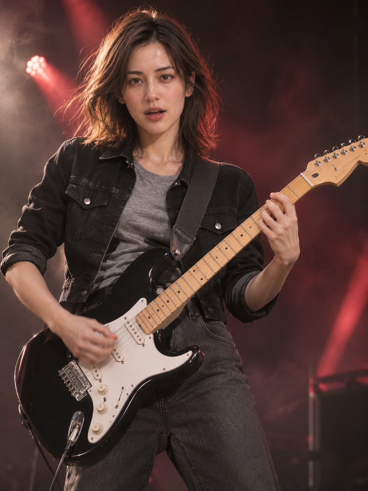
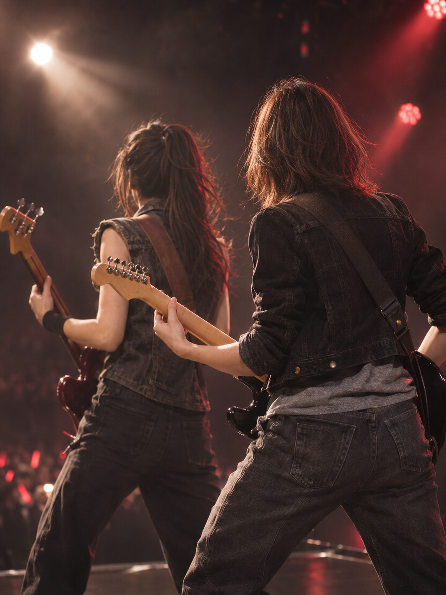
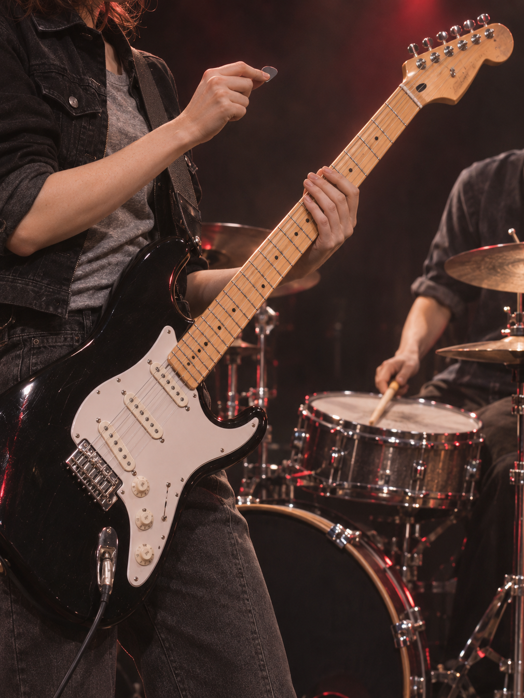
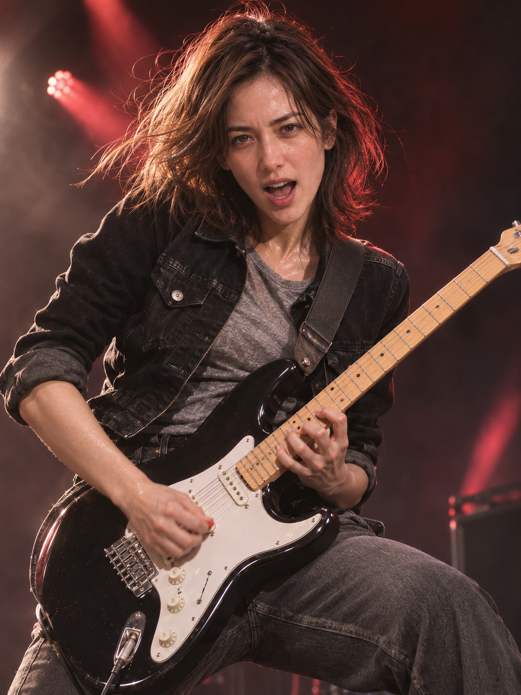
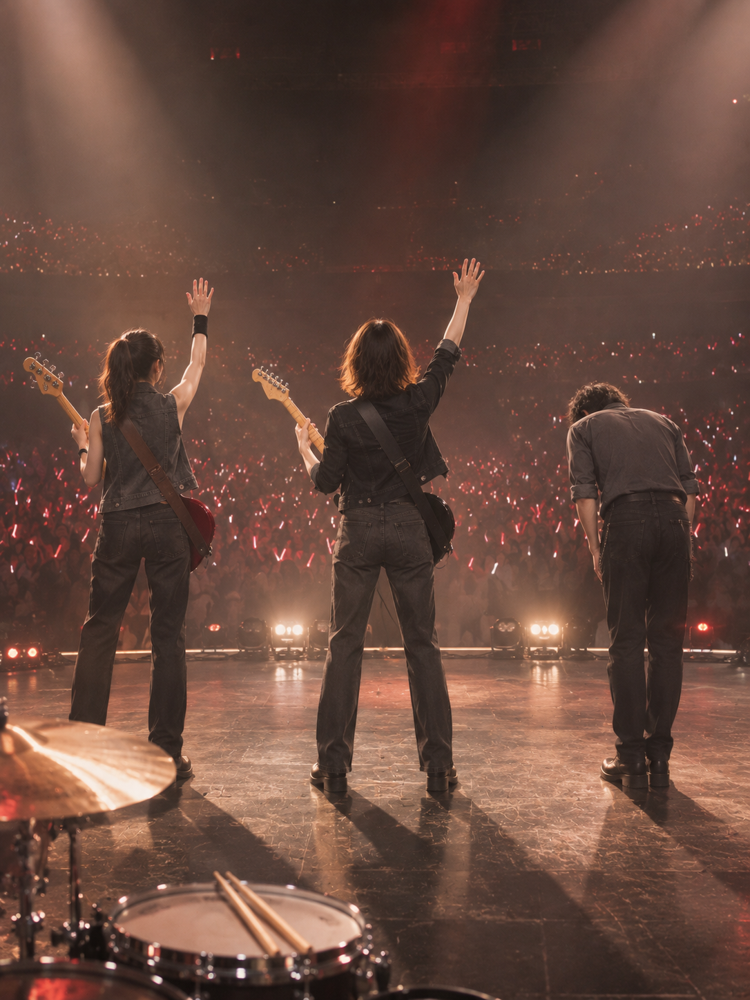

# 最后一个和弦 · 修订前五张历史记录

> 本页保留贝斯弦数修正前的五张、原检查结论及作者纠错。第2、5张已由[当前案例](virtual-last-chord.md)的新修订替换，不重复计入当前图库。
> Historical five-shot version before the bass correction. Shots 2 and 5 have been replaced in the [current case](virtual-last-chord.md); this page is excluded from the current gallery count.

> **待修正：贝斯弦数。** 作者指出贝斯被画成三弦，未符合本套明确的四弦设定。此前检查漏核了弦数、弦钮与琴桥的对应关系；第2、5张贝斯镜头需重新核对修订，不能当作乐器结构通过的案例。图片暂保留为问题记录。
> **Correction pending: bass string count.** The owner reports a three-string bass where this set specifies four. The earlier review did not verify strings against tuning machines and bridge connections. Shots 2 and 5 require review/correction and must not be treated as verified instrument structure; these images remain as the issue record.

[全部案例 / All cases](../CASES.md) · [English index](../CASES.en.md) · [开始使用 / Get started](../../README.md)

**五张重制 · AI 生成 · 原创虚拟成年人物。** 开场、贝斯合奏、鼓手回应、独奏高潮与共同谢幕。黑色夹克、银灰上衣、黑色白护板电吉他与红色舞台光串起同一场演出。

**Five-shot remake · AI-generated · Original virtual adult subject.** An opening downbeat, a duet with the bassist, a cue to the drummer, a solo peak and a shared final salute. A black jacket, silver-grey top and black guitar with a white pickguard connect the performance.

## 五张重制图 / The five new images

### 1. 第一记重拍 / The opening downbeat

<a href="../../assets/showcase/virtual-last-chord-remake/01-opening.png"></a>

### 2. 与贝斯手同拍 / In time with the bassist

<a href="../../assets/showcase/virtual-last-chord-remake/02-bass-duet.png"></a>

### 3. 回应鼓手的重拍 / Cueing the drummer

<a href="../../assets/showcase/virtual-last-chord-remake/03-drummer-cue.png"></a>

### 4. 独奏的最高点 / The solo peak

<a href="../../assets/showcase/virtual-last-chord-remake/04-solo-peak.png"></a>

### 5. 一起谢幕 / The final salute

<a href="../../assets/showcase/virtual-last-chord-remake/05-band-salute.png"></a>

## 重制范围 / What changed

作者指出旧案例错误较多，要求重新生成后更新GitHub，并明确选择完整五张含谢幕。本轮另开新套，5次调用返回5张，0自动重试；旧四张和旧第五张结果待核的记录保留在[历史问题版本](virtual-last-chord-original.md)，不计入当前图库。

The owner identified errors in the earlier case and requested a full five-shot remake followed by a GitHub update. This new run returned five images from five calls, with no automatic retries. The [earlier four images and unresolved fifth call](virtual-last-chord-original.md) remain in the historical record and are excluded from the current gallery count.

先修正了分镜里正面机位与琴颈方向相冲突的描述，并补充按人物自身左右写持琴习惯、琴颈至琴桥结构连续和首图纠正优先级。新图目视可见的持琴方向一致，旧版第③张的琴弦折向与指板错接没有再出现；谢幕的鼓组位于人物身后。

The storyboard first corrected a conflict between the frontal camera and the guitar-neck direction. Revised guidance describes anatomical handedness, neck-to-bridge continuity and explicit corrections when using a first-shot reference. Visible handedness is consistent in the remake, the old shot 3 string/fretboard error is not visible, and the drum kit stays behind the musicians in the final salute.

## 检查与限制 / Checks and limits

- 五张原字节PNG与AI来源标识保留，文件完整性检查通过。部分拨弦手、肩带挂点、鼓凳与踏板被遮挡，细指法没有完整核验；贝斯手护腕位置在合奏与谢幕之间仍有细节漂移。
- 按作者明确的重拍与公开更新要求展示；尚未取得本轮新图的逐张用户验收，不将旧版认可移给新版，也不据此宣布乐器或真人身份稳定通过。
- 使用已修订的开发源码编译器与内置生图，沿用原创虚拟人物参考，并用本轮首图保持衣装和影调；旧问题图未作参考。虚拟素材来源措辞单独记录，不作为正式真人CLI全流程验证。
- 机器比脸不可用，自动构图检测不可用；五次调用审计均无法唯一定位完整请求窗口，记录为unverifiable。固定v1.1.0-rc.1安装包未因这次源码与案例更新而重发。

Original PNG bytes and AI provenance are preserved, and file-integrity checks passed. Some hands, strap mounts and drum supports remain occluded, fine technique is not fully verified, and the bassist's wristband placement varies. The owner authorized regeneration and public updating; post-generation per-image acceptance is still pending. This run used revised development-source guidance with an original virtual-subject reference and its own first image for continuity. It does not establish real-person identity reliability or a formal real-person CLI workflow. Machine likeness and framing detectors were unavailable; all five automatic request audits were unverifiable. The fixed v1.1.0-rc.1 installer has not been republished.

## 可以这样开始 / Try this

```text
用入画设计一套我当吉他手的摇滚现场五张分镜，
要有与贝斯手、鼓手互动的镜头。先看分镜，不生图。
```

```text
Use shy-cameo to plan five shots of me as a guitarist at a rock concert,
including interactions with a bassist and drummer. Show the storyboard first;
do not generate images yet.
```

[图片摘要 / Image manifest](../../assets/showcase/virtual-last-chord-remake/manifest.json) · [旧问题版本 / Historical version](virtual-last-chord-original.md) · [能力与限制 / Capabilities](../CAPABILITIES.en.md)
