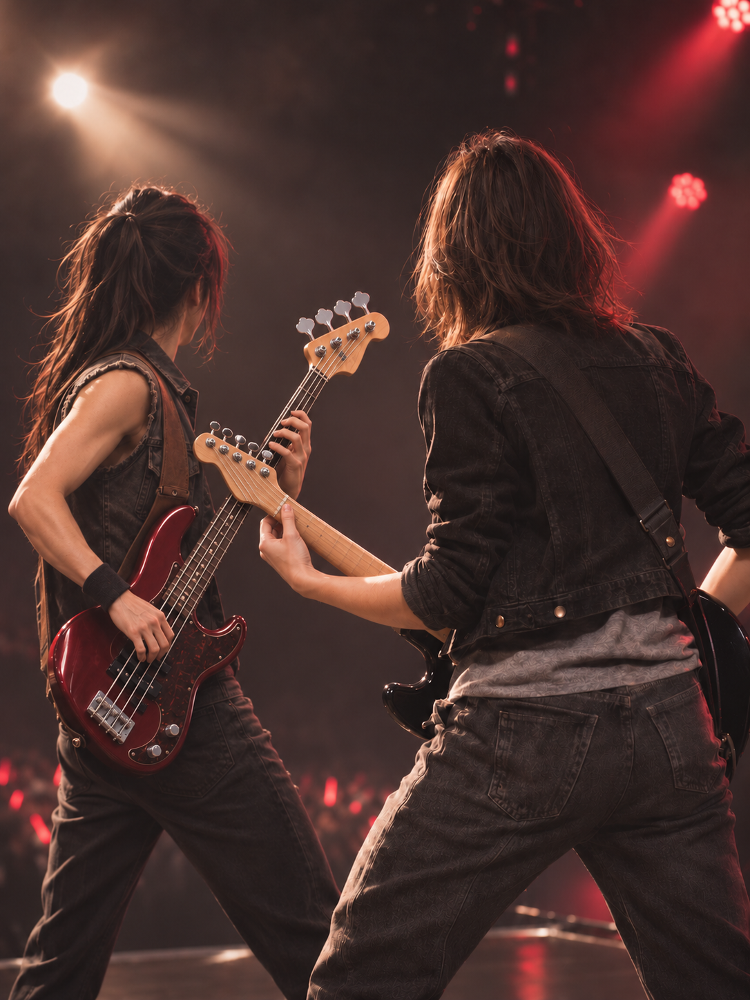
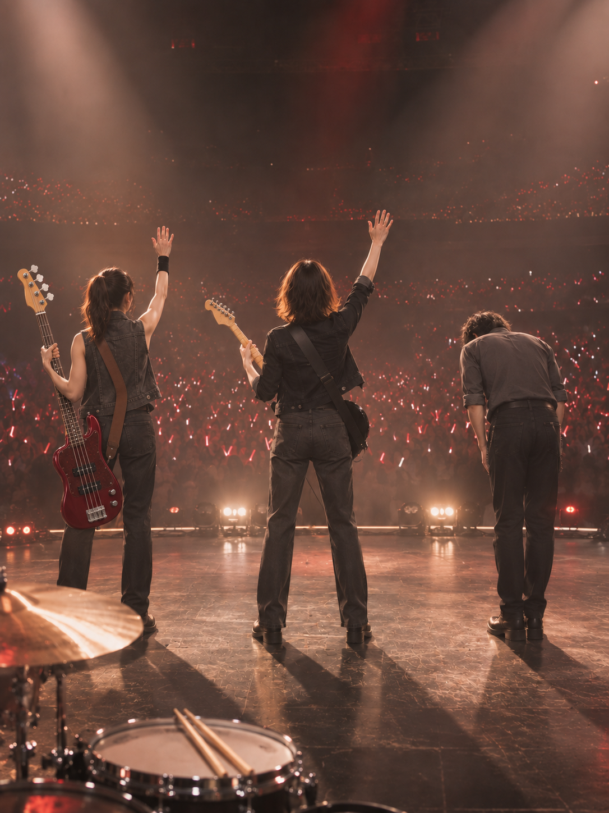

# 最后一个和弦 · The Last Chord

[全部案例 / All cases](../CASES.md) · [English index](../CASES.en.md) · [开始使用 / Get started](../../README.md)

**五张故事图 · 乐器修订版 · AI生成 · 原创虚拟成年人物。** 开场、贝斯合奏、鼓手回应、独奏高潮与共同谢幕。第2、5张已针对贝斯弦数修订，其余三张保留原图。

**Five-image story · Instrument revision · AI-generated fictional adults.** The bass duet and final salute have been revised; the other three images retain their original bytes.

## 当前五张 / Current five images

### 1. 第一记重拍 / The opening downbeat

<a href="../../assets/showcase/virtual-last-chord-remake/01-opening.png"></a>

### 2. 与贝斯手同拍 / In time with the bassist

<a href="../../assets/showcase/virtual-last-chord-remake/02-bass-duet-r2.png"></a>

### 3. 回应鼓手的重拍 / Cueing the drummer

<a href="../../assets/showcase/virtual-last-chord-remake/03-drummer-cue.png"></a>

### 4. 独奏的最高点 / The solo peak

<a href="../../assets/showcase/virtual-last-chord-remake/04-solo-peak.png"></a>

### 5. 一起谢幕 / The final salute

<a href="../../assets/showcase/virtual-last-chord-remake/05-band-salute-r1.png"></a>

## 这次修正了什么 / What changed

作者指出上一版贝斯只有三弦，要求继续完善图片并更新GitHub。本轮针对第2、5张共进行了3次编辑，选用2张：第2张先修好四弦贝斯，但出现主角吉他琴头丢失的附带问题，再用独立请求修回琴头；第5张完成一次贝斯修订。三次均返回图片，未重交失败或结果未知的请求。

目视检查中，两张新图可数出贝斯的四根弦、四个独立弦钮及对应琴桥结构；琴头完整入镜，琴颈与琴体连续。第2张恢复了主角吉他的完整琴头，两把琴按前后遮挡分开。贝斯手护腕统一在右腕，谢幕鼓组仍在乐手身后。第1、3、4张未改字节。

The owner reported a three-string bass and requested further refinement and a GitHub update. Three edit calls produced two selected replacements: the first duet edit corrected the bass but accidentally removed the main guitar headstock, which a separate edit restored; the salute received one bass edit. All three calls returned images. No failed or unresolved request was resubmitted.

Manual inspection of the selected images shows four bass strings, four separate tuning keys and the visible bridge connections. Both bass headstocks are fully in frame. The duet keeps the restored guitar headstock distinct from the bass; the bassist's wristband is on the right wrist in both images. The salute retains the drum kit behind the performers. Shots 1, 3 and 4 are byte-identical to the preceding version.

## 检查与限制 / Checks and limits

- 原生PNG、AI来源信息及旧版均保留；文件可解码，展示副本与原始输出字节一致。
- 目视结论限可见的弦数与连接，细指法、细小弦槽和遮挡挂点未完整核验；这组图不证明乐器细节或真人身份可以稳定复现。
- 本次沿用已有虚拟人物成图作为编辑底图，使用开发源的`compile_edit_request`和内置生图；不作为正式真人CLI端到端验证。
- 三次编辑的自动调用审计均为`unverifiable`，原因是未找到可用会话日志；人脸与构图检测器不可用。原五张重制的审计边界另保留在历史页。文件完整性不替代调用审计或用户验收。
- 按作者明确的完善与公开更新要求展示，新修订的逐张用户验收仍待记录；没有移用旧版认可。

Native PNG bytes and AI provenance are retained. Visible counts and connections were inspected, while fine technique, tiny nut slots and hidden attachments remain unverified. The three edit audits are unverifiable because usable session logs were unavailable; face and framing detectors were unavailable. Public updating was explicitly authorized, but formal per-image user acceptance remains pending. This is a virtual-subject development case, not proof of real-person identity or reliable instrument anatomy.

## 版本记录 / Version history

- [最早四张与未知第五张 / Original four images and unresolved fifth call](virtual-last-chord-original.md)：5次调用返回4张，未知第五张保持原状态。
- [修订前五张 / Five images before this correction](virtual-last-chord-remake-history.md)：独立重制5次返回5张，保留作者的贝斯弦数纠错与旧图。
- 当前版本：在上述五张基础上增加3次编辑，选用2张替换展示；仍计5张故事图，历史版本不重复计数。固定v1.1.0-rc.1安装包未重发。

## 可以这样开始 / Try this

```text
用入画设计一套我当吉他手的摇滚现场五张分镜，
要有与贝斯手、鼓手互动的镜头。先看分镜，不生图。
```

```text
Use shy-cameo to plan five shots of me as a guitarist at a rock concert,
including interactions with a bassist and drummer. Show the storyboard first;
do not generate images yet.
```

[图片摘要与选版 / Image manifest and selection](../../assets/showcase/virtual-last-chord-remake/manifest.json) · [能力与限制 / Capabilities](../CAPABILITIES.en.md)
