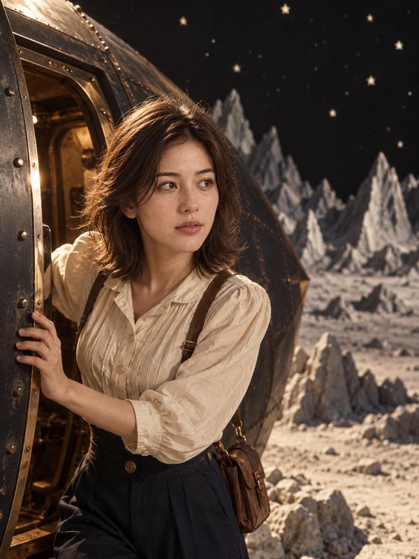
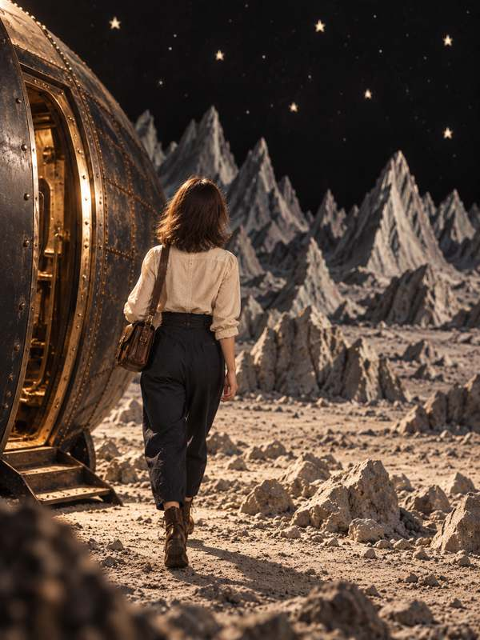
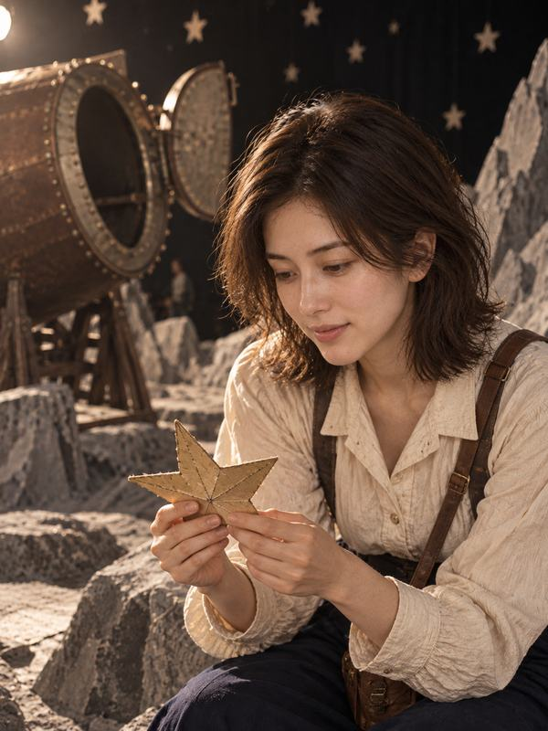
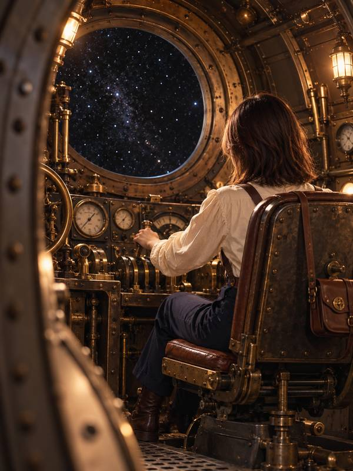

# 月球旅行记：进入默片片场 · A Trip to the Moon: Inside a Silent Film

[全部案例 / All cases](../CASES.md) · [English index](../CASES.en.md) · [开始使用 / Get started](../../README.md)

**AI 生成 · 原创虚拟成年模特，非真人照片。 / AI-generated virtual adult; no real model is depicted.**

走进一个故事 · 电影场景 · 1902年默片舞台景观<br>
Enter a story · a film setting · A theatrical world inspired by the 1902 silent film

## 五张成片 / Five-shot set

<p>
<a href="../../assets/showcase/virtual-moon-film/01.jpg"></a>
<a href="../../assets/showcase/virtual-moon-film/02.jpg"></a>
<a href="../../assets/showcase/virtual-moon-film/03.jpg"></a>
<a href="../../assets/showcase/virtual-moon-film/04.jpg"></a>
<a href="../../assets/showcase/virtual-moon-film/05.jpg"></a>
</p>

## 可以这样开始 / Try this

```text
走进1902年默片《月球旅行记》的场景，五张有不同姿态与剧情作用。先看分镜，不生图。
```

```text
Step into the world of the 1902 silent film A Trip to the Moon. Plan five distinct poses and story moments; do not generate images yet.
```

## 选用版本与范围 / Selection and scope

采用复验修订版，反馈为“基本解决，继续推进”；这套解决了主要重复问题，不代表所有场景的姿态重复都已解决。

Uses the revised set accepted as substantially improved. The main repetition issue was addressed in this example, without establishing that all pose repetition is solved.

这套为已获认可的开发阶段 AI 模特创作案例。制作中使用编译指导与原生生图，并按虚拟主体调整了措辞；不据此声称真人正式 CLI 流程端到端通过。此处为原有成片的网页尺寸副本，原图保留，本次展示没有重新生图。

This accepted development example used compiler-guided/native image generation with wording adapted for a virtual subject. It does not establish a complete real-person CLI workflow. These are web copies of existing outputs; originals were retained and no new images were generated for this publication.

[版本及图片摘要 / Image manifest](../../assets/showcase/virtual-moon-film/manifest.json)

[安装入画](../INSTALL.md) · [能力与限制 / Capabilities](../CAPABILITIES.en.md)
