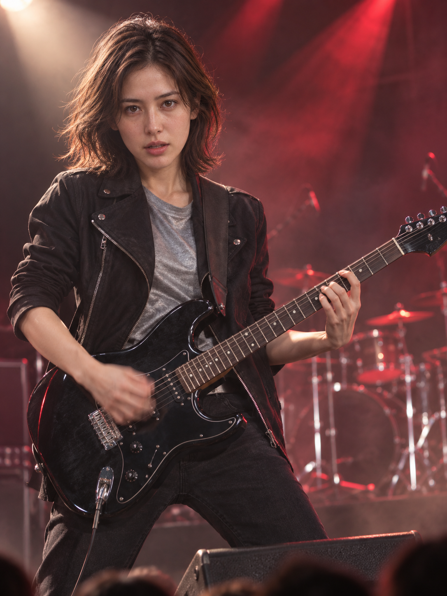
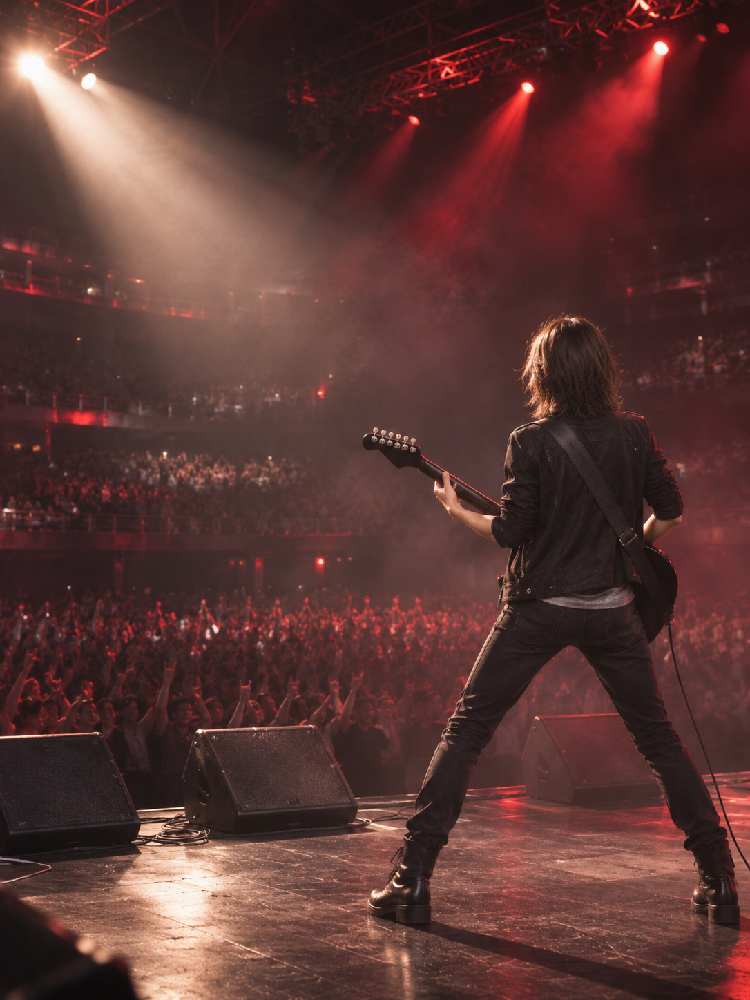
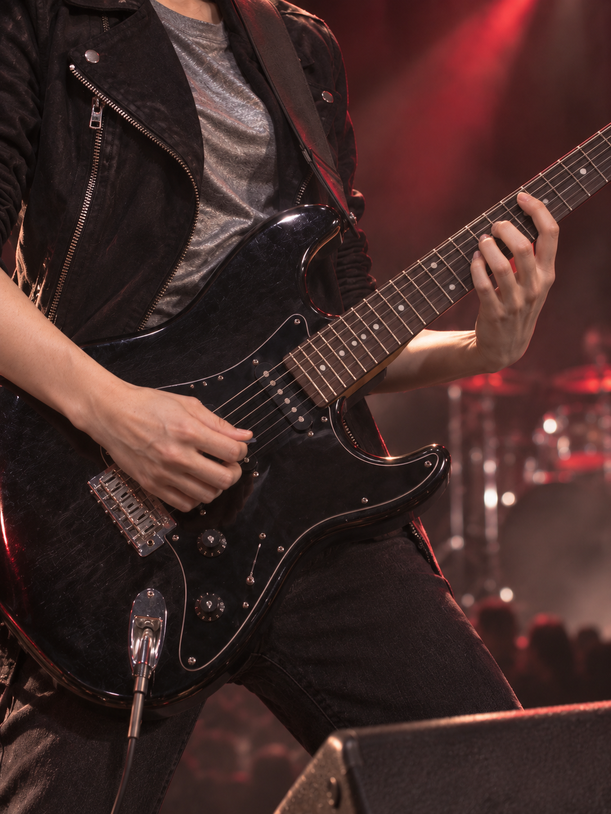
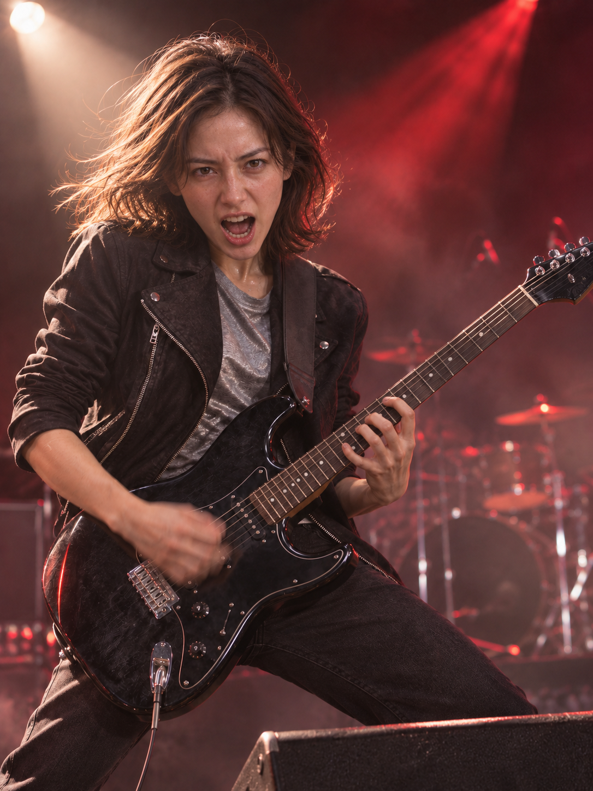
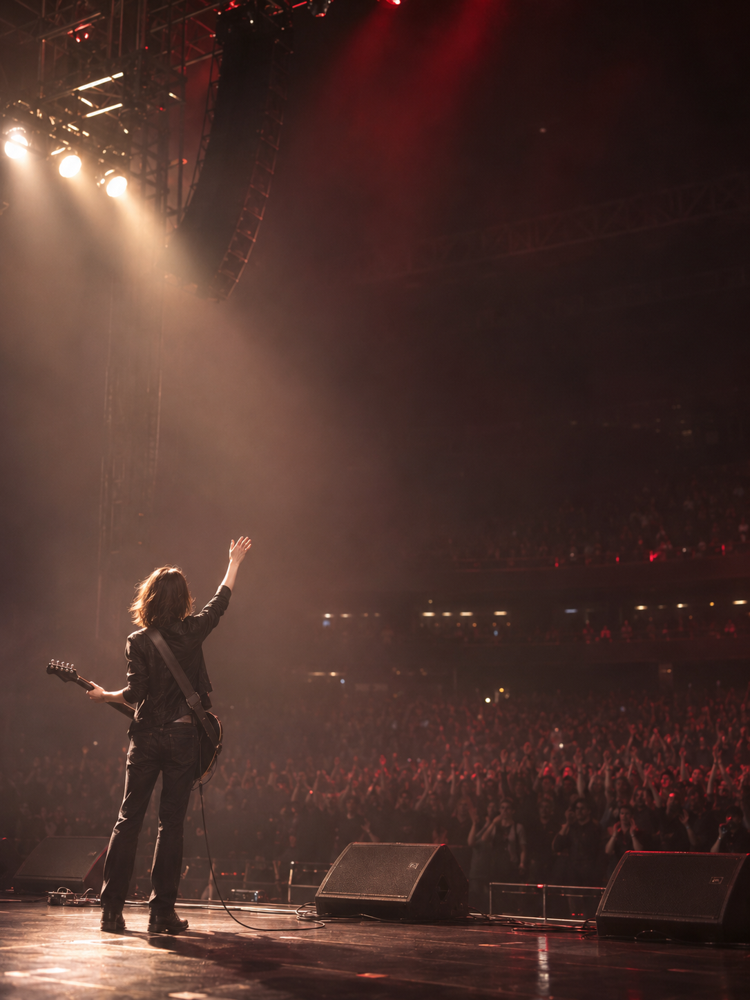
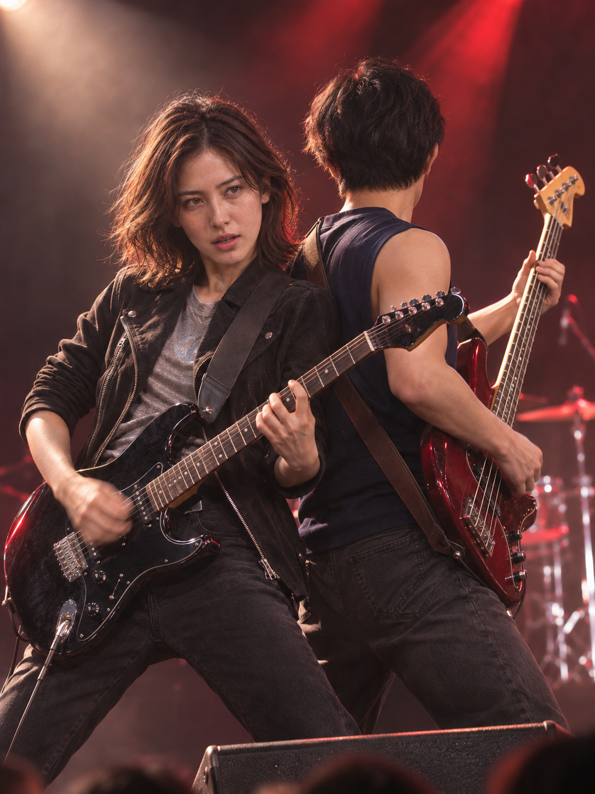
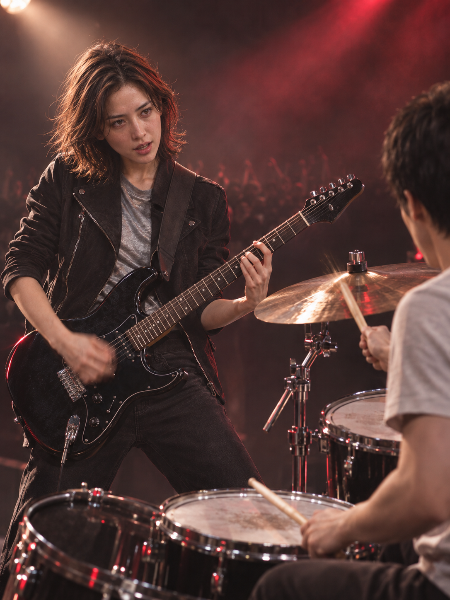
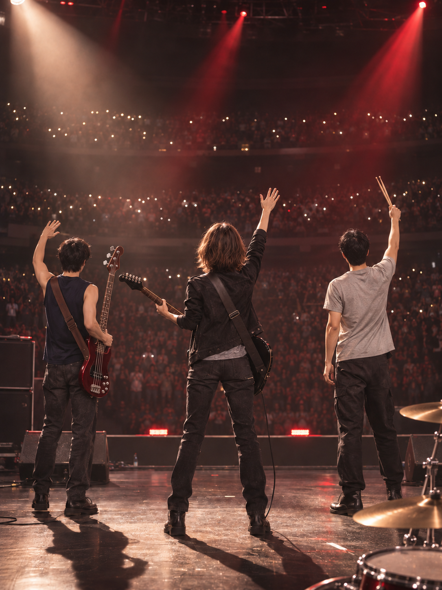

# 我的舞台：电吉他手的五个瞬间 · My Stage: Five Moments with an Electric Guitar

[全部案例 / All cases](../CASES.md) · [English index](../CASES.en.md) · [开始使用 / Get started](../../README.md)

**AI 生成 · 原创虚拟成年人物的想象摇滚现场。** 主角是自己舞台上的电吉他手，保留自己的身份；没有使用真实人物身份照片。

**AI-generated.** An original virtual adult performs as an electric guitarist at an imagined rock concert, retaining their own identity. No real-person identity photograph was used.

开发版试验玩法，尚未包含在 **v1.0.3-rc.1**。 / Experimental development-source feature, **not included in v1.0.3-rc.1**.

## 五张成片 / Five-shot set

开场重拍 → 投入演奏 → 琴弦细节 → 独奏高潮 → 最后一声和弦后的致意。

The opening downbeat → playing to the crowd → fingers on the strings → the solo peak → the final salute.

<p>
<a href="../../assets/showcase/virtual-my-stage-guitar/01.png"></a>
<a href="../../assets/showcase/virtual-my-stage-guitar/02.png"></a>
<a href="../../assets/showcase/virtual-my-stage-guitar/03.png"></a>
<a href="../../assets/showcase/virtual-my-stage-guitar/04.png"></a>
<a href="../../assets/showcase/virtual-my-stage-guitar/05.png"></a>
</p>

## 队友互动补充 / Band interaction supplement

原五张保留，以下三张是另外选用的互动镜头：与贝斯手背靠背合奏、回应鼓手、共同谢幕。前两张由作者明确保留，谢幕选用修订1；它们尚未重组为另一套五张故事。

The original five-shot story remains above. These three additional selections show a bass duet, a response to the drummer and a shared final salute. The owner retained the first two and selected revision 1 of the salute; they are a supplement, not another five-shot set.

<p>
<a href="../../assets/showcase/virtual-my-stage-band/01-bass-duet.png"></a>
<a href="../../assets/showcase/virtual-my-stage-band/02-drummer-cue.png"></a>
<a href="../../assets/showcase/virtual-my-stage-band/03-band-salute-r1.png"></a>
</p>

互动部分实际用了4次调用：最初3张，加作者要求的1次谢幕修订，没有自动重试。谢幕修订把原先位于人物与观众之间的鼓组移至右下近景，并补全可读的贝斯琴颈。此前的空间与结构问题保留在开发记录中，不将本次选用概括成一次生成全部正确。

The supplement took four calls: three initial images and one requested edit, with no automatic retries. The selected salute moves the drums from the area between the performers and audience into the near foreground and restores a readable bass neck. This selection does not imply that all initial outputs were correct.

合奏中的扫弦手有运动模糊，鼓手的鼓凳与踏板在画外，精细指法、弦钮及弦数没有完整核验；用户认可限于这三张虚拟人物作品，不证明真人身份或其他乐器稳定。原字节PNG与AI来源标识保留。

Strumming includes motion blur; the drummer's seat and pedals are out of frame; precise technique, tuning pegs and string counts have not been fully checked. Acceptance applies to these selected virtual-subject images, not general real-person or instrument reliability. Original PNG bytes and AI provenance are retained.

[互动图片摘要 / Supplement manifest](../../assets/showcase/virtual-my-stage-band/manifest.json)

## 可以这样开始 / Try this

```text
我要当电吉他手，用五张拍出自己的摇滚现场：开场、投入演奏、琴弦细节、独奏高潮和谢幕。先给分镜，不生图。
```

```text
Make me an electric guitarist at my own rock concert. Plan five shots: the opening, playing to the crowd, guitar detail, the solo peak and the final salute. Do not generate images yet.
```

## 选用版本与范围 / Selection and scope

2026-11-03，作者明确反馈：“整套认可，可以作为展示案例”。5次调用得到5张、0重试，本页收录同一组原图。使用已有纯编译器与内置生图，按虚拟主体适配素材来源措辞；这是整套用户认可，不代填正式真人 CLI 的逐张验收。

The owner accepted the whole set and explicitly approved showcase inclusion on 2026-11-03. Five calls returned five images without retries. This development POC used native generation and compiler guidance adapted for the virtual subject; it does not establish a formal real-person CLI run.

已保留的观察：第2张人物比计划远景更大；第1与4张前方机位较接近；第3张未明显达到预设高把位。运动模糊、肩带挂点、弦钮及具体指法没有完整验证。整套认可不代表所有乐器或真人大动作相似度稳定。

Known limitations remain: the subject is larger than planned in shot 2; shots 1 and 4 share similar frontal framing; shot 3 does not clearly reach the planned high fret position. Motion blur, strap attachments, tuning pegs and precise technique have not been fully verified.

原五张展示单人表演故事，队友互动的实际结果另见本页补充三张。两部分均保留原字节 PNG 与 AI 来源标识；本次收录整理没有追加生图或重编码。

The original five images show individual performance; band interactions are documented in the separate three-image supplement on this page. Both retain the original PNG bytes and AI provenance, with no extra generation or re-encoding for this gallery update.

[图片摘要 / Image manifest](../../assets/showcase/virtual-my-stage-guitar/manifest.json) · [能力与限制 / Capabilities](../CAPABILITIES.en.md)

另见新版制作的[《最后一个和弦》四张选集 / The Last Chord, a separate four-image selection](virtual-last-chord.md)。这组保留已观察问题与未返回的谢幕记录，不替换本页原五张或三张互动补充。
