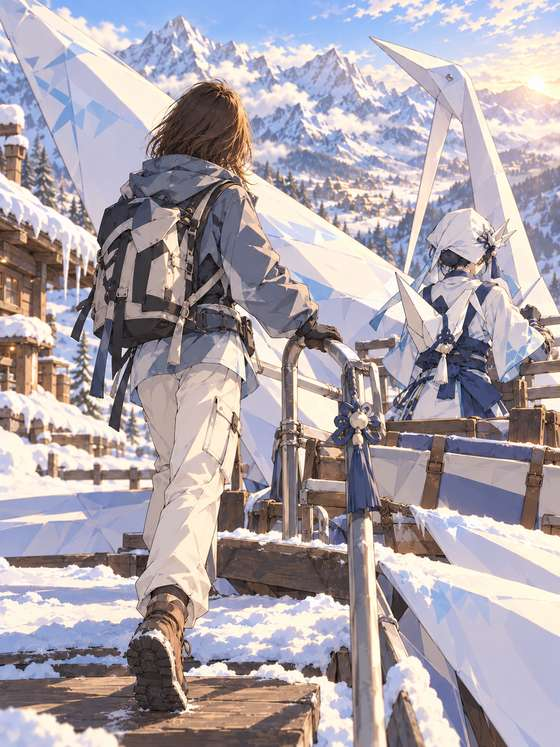
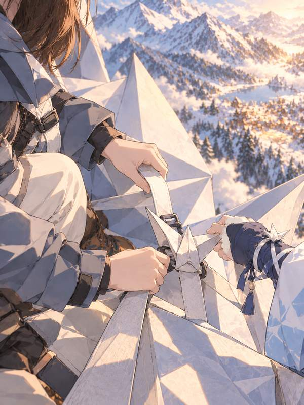
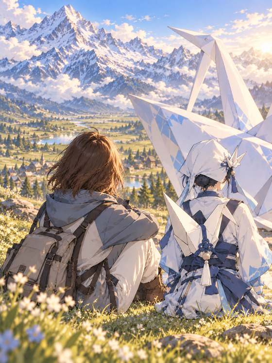

# 纸鸢的动画冒险 · An Animated Adventure with Zhiyuan

[全部案例 / All cases](../CASES.md) · [English index](../CASES.en.md) · [开始使用 / Get started](../../README.md)

**AI 生成 · 原创虚拟成年模特，非真人照片。 / AI-generated virtual adult; no real model is depicted.**

走进一个故事 · 原创角色冒险 · 人物与世界都动画化<br>
Enter a story · an original character adventure · Animated subject and world

## 五张成片 / Five-shot set

<p>
<a href="../../assets/showcase/virtual-paper-crane/01.jpg"></a>
<a href="../../assets/showcase/virtual-paper-crane/02.jpg"></a>
<a href="../../assets/showcase/virtual-paper-crane/03.jpg"></a>
<a href="../../assets/showcase/virtual-paper-crane/04.jpg"></a>
<a href="../../assets/showcase/virtual-paper-crane/05.jpg"></a>
</p>

## 可以这样开始 / Try this

```text
和原创角色纸鸢经历一场小冒险，我和背景都用动画画风。先看五张分镜，不生图。
```

```text
Go on a small adventure with the original character Zhiyuan. Render both me and the world in an animated style. Plan five shots; do not generate images yet.
```

## 选用版本与范围 / Selection and scope

首图采用修订版，整套获认可；动画化会改变五官比例，不作为真人身份精确保留证据。

The accepted set uses a revised first shot. Animation changes facial proportions and is not evidence of precise real-person identity preservation.

这套为已获认可的开发阶段 AI 模特创作案例。制作中使用编译指导与原生生图，并按虚拟主体调整了措辞；不据此声称真人正式 CLI 流程端到端通过。此处为原有成片的网页尺寸副本，原图保留，本次展示没有重新生图。

This accepted development example used compiler-guided/native image generation with wording adapted for a virtual subject. It does not establish a complete real-person CLI workflow. These are web copies of existing outputs; originals were retained and no new images were generated for this publication.

[版本及图片摘要 / Image manifest](../../assets/showcase/virtual-paper-crane/manifest.json)

[安装入画](../INSTALL.md) · [能力与限制 / Capabilities](../CAPABILITIES.en.md)
