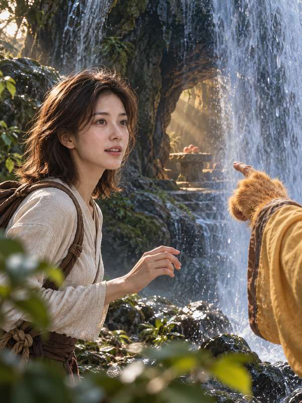
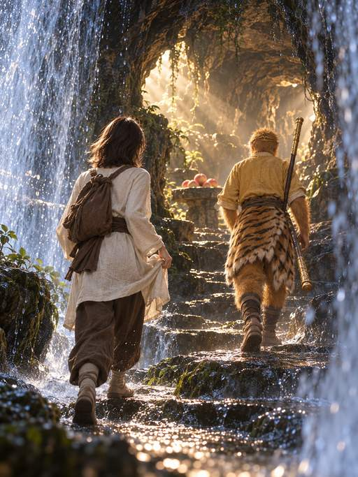
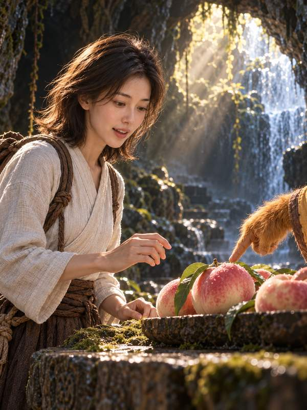
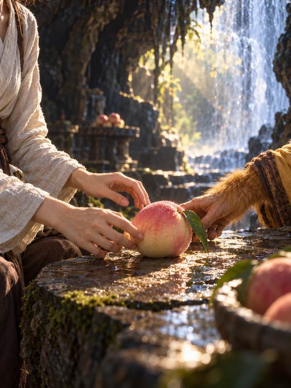
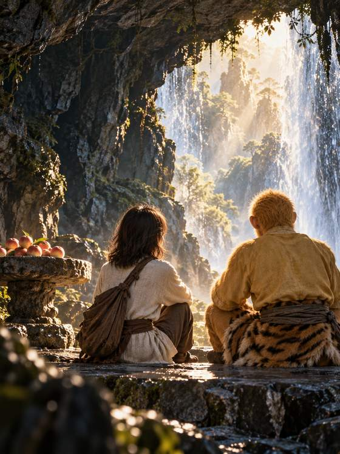

# 跟孙悟空走进水帘洞 · Into Water Curtain Cave with Sun Wukong

[全部案例 / All cases](../CASES.md) · [English index](../CASES.en.md) · [开始使用 / Get started](../../README.md)

**AI 生成 · 原创虚拟成年模特，非真人照片。 / AI-generated virtual adult; no real model is depicted.**

和角色同框 · 进他的世界 · 摄影感故事写真<br>
Character companionship · enter their world · Photographic story portraits

## 五张成片 / Five-shot set

<p>
<a href="../../assets/showcase/virtual-wukong-cave/01.jpg"></a>
<a href="../../assets/showcase/virtual-wukong-cave/02.jpg"></a>
<a href="../../assets/showcase/virtual-wukong-cave/03.jpg"></a>
<a href="../../assets/showcase/virtual-wukong-cave/04.jpg"></a>
<a href="../../assets/showcase/virtual-wukong-cave/05.jpg"></a>
</p>

## 可以这样开始 / Try this

```text
去花果山找孙悟空，和他一起走进水帘洞。五张有不同的动作和故事推进，先看分镜，不生图。
```

```text
Find Sun Wukong at Flower-Fruit Mountain and enter Water Curtain Cave with him. Plan five distinct moments first; do not generate images.
```

## 选用版本与范围 / Selection and scope

采用修订后的第二张，其余沿用已认可版本；不把这一套的效果推广为所有角色都能稳定辨认。

Uses the revised second shot and the accepted versions of the other four. This example does not establish reliable recognition of every character.

这套为已获认可的开发阶段 AI 模特创作案例。制作中使用编译指导与原生生图，并按虚拟主体调整了措辞；不据此声称真人正式 CLI 流程端到端通过。此处为原有成片的网页尺寸副本，原图保留，本次展示没有重新生图。

This accepted development example used compiler-guided/native image generation with wording adapted for a virtual subject. It does not establish a complete real-person CLI workflow. These are web copies of existing outputs; originals were retained and no new images were generated for this publication.

[版本及图片摘要 / Image manifest](../../assets/showcase/virtual-wukong-cave/manifest.json)

[安装入画](../INSTALL.md) · [能力与限制 / Capabilities](../CAPABILITIES.en.md)
