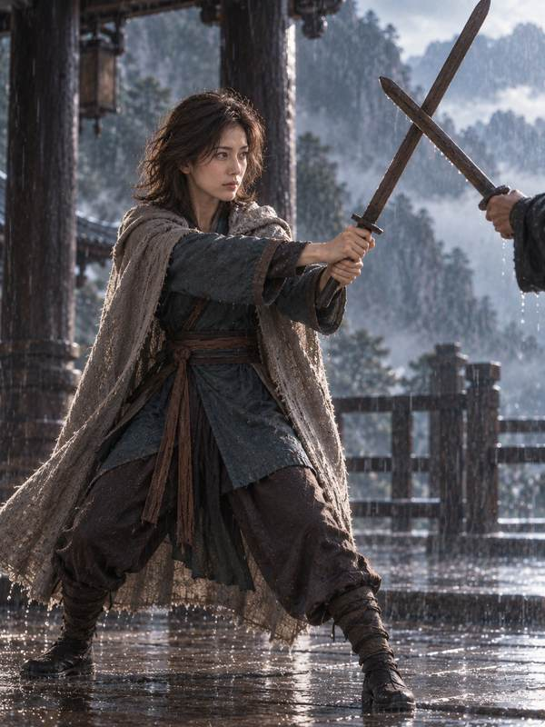

# 栈道上的武侠交锋 · A Wuxia Encounter on the Cliff Path

[全部案例 / All cases](../CASES.md) · [English index](../CASES.en.md) · [开始使用 / Get started](../../README.md)

**AI 生成 · 原创虚拟成年模特，非真人照片。 / AI-generated virtual adult; no real model is depicted.**

走进一个故事 · 类型电影 · 武侠电影摄影感<br>
Enter a story · genre cinema · Wuxia-inspired cinematic photography

## 五张成片 / Five-shot set

<p>
<a href="../../assets/showcase/virtual-wuxia/01.jpg"></a>
<a href="../../assets/showcase/virtual-wuxia/02.jpg"></a>
<a href="../../assets/showcase/virtual-wuxia/03.jpg"></a>
<a href="../../assets/showcase/virtual-wuxia/04.jpg"></a>
<a href="../../assets/showcase/virtual-wuxia/05.jpg"></a>
</p>

## 可以这样开始 / Try this

```text
拍一套武侠栈道上的遭遇，要有对手的影子、交锋和收势。先看五张分镜，不生图。
```

```text
Plan a wuxia encounter on a cliff path, with an opponent’s shadow, a confrontation and a closing moment. Show five shots first; do not generate images.
```

## 选用版本与范围 / Selection and scope

采用加入对手、交锋与收势的获认可修订版；重点展示事件和镜头变化，不承诺武术动作考据。

Uses the accepted revision with an opponent and a clearer confrontation. Demonstrates narrative and shot variation, without a claim of martial-arts accuracy.

这套为已获认可的开发阶段 AI 模特创作案例。制作中使用编译指导与原生生图，并按虚拟主体调整了措辞；不据此声称真人正式 CLI 流程端到端通过。此处为原有成片的网页尺寸副本，原图保留，本次展示没有重新生图。

This accepted development example used compiler-guided/native image generation with wording adapted for a virtual subject. It does not establish a complete real-person CLI workflow. These are web copies of existing outputs; originals were retained and no new images were generated for this publication.

[版本及图片摘要 / Image manifest](../../assets/showcase/virtual-wuxia/manifest.json)

[安装入画](../INSTALL.md) · [能力与限制 / Capabilities](../CAPABILITIES.en.md)
