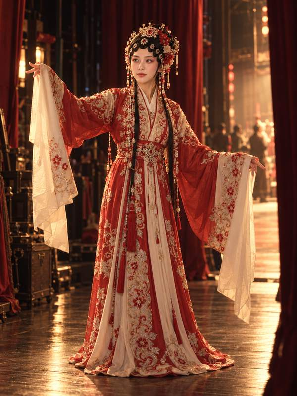
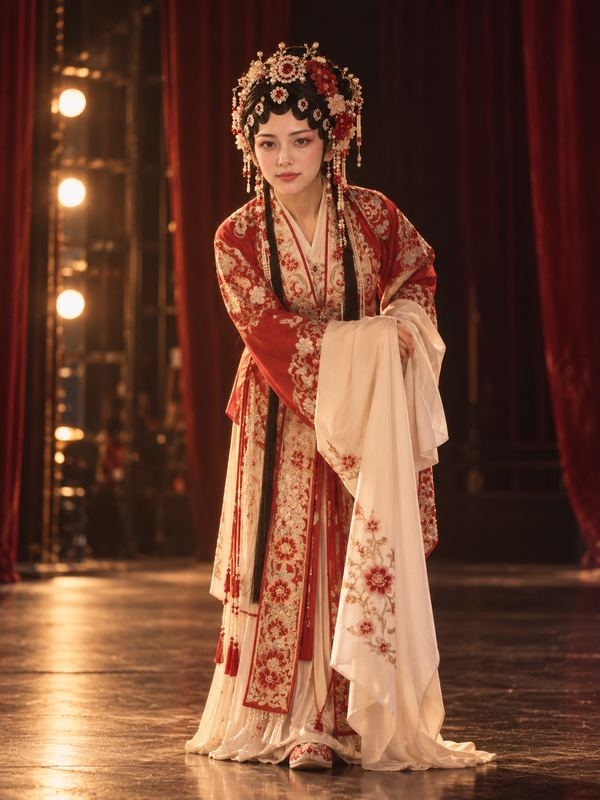

# 虞姬：从后台到舞台 · Yuji: Backstage to the Stage

[全部案例 / All cases](../CASES.md) · [English index](../CASES.en.md) · [开始使用 / Get started](../../README.md)

**AI 生成 · 原创虚拟成年模特，非真人照片。 / AI-generated virtual adult; no real model is depicted.**

扮成一个人 · 中国戏曲 · 戏曲主题摄影<br>
Costume portraits · Chinese opera · Opera-inspired photography

## 五张成片 / Five-shot set

<p>
<a href="../../assets/showcase/virtual-yuji-opera/01.jpg"></a>
<a href="../../assets/showcase/virtual-yuji-opera/02.jpg"></a>
<a href="../../assets/showcase/virtual-yuji-opera/03.jpg"></a>
<a href="../../assets/showcase/virtual-yuji-opera/04.jpg"></a>
<a href="../../assets/showcase/virtual-yuji-opera/05.jpg"></a>
</p>

## 可以这样开始 / Try this

```text
穿虞姬的戏曲扮相，拍一套从后台准备到舞台亮相的故事写真。先看五张分镜，不生图。
```

```text
Plan a five-shot opera-inspired Yuji portrait set, from backstage preparation to the stage. Do not generate images yet.
```

## 选用版本与范围 / Selection and scope

补拍化妆师局部互动和面对观众的舞台背影后获认可；是戏曲主题创作，不作精确服制复原承诺。

Accepted after revising the makeup interaction and the back view facing the audience. An opera-inspired creative set, without a claim of exact historical costume reconstruction.

这套为已获认可的开发阶段 AI 模特创作案例。制作中使用编译指导与原生生图，并按虚拟主体调整了措辞；不据此声称真人正式 CLI 流程端到端通过。此处为原有成片的网页尺寸副本，原图保留，本次展示没有重新生图。

This accepted development example used compiler-guided/native image generation with wording adapted for a virtual subject. It does not establish a complete real-person CLI workflow. These are web copies of existing outputs; originals were retained and no new images were generated for this publication.

[版本及图片摘要 / Image manifest](../../assets/showcase/virtual-yuji-opera/manifest.json)

[安装入画](../INSTALL.md) · [能力与限制 / Capabilities](../CAPABILITIES.en.md)
