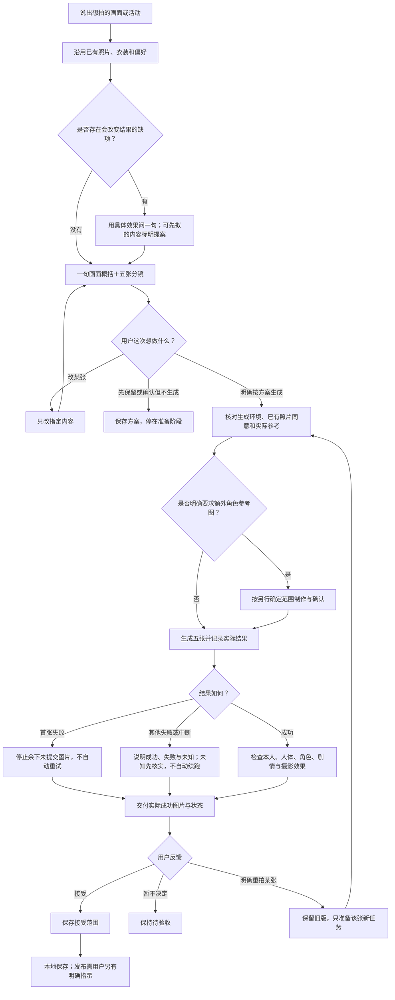

# 开发与复现

## 当前决定：P2 已验收，P3 取消，P4 交作者手测（2026-11-02）

P2 强制读取补跑 M01/M06 均通过，按作者条件验收。P3 的 next 命令取消，仅开放已有构图建议 CLI。新 description 与 [自动发现手测](AUTO-DISCOVERY.md) 已准备，真实安装下的 M01/M02 待作者执行；图库只做最简提案，尚未拆分。P1 自动化继续冻结。当前执行范围以 优化计划（素材未包含于源码包） 为准，以下旧段落保留其当时状态。

## 当前决定：P1 自动化暂停，进入轻量 P2（2026-11-02）

**暂停，待项目有真实用户后再启用。** 自动化运行器、隔离方案及既有证据保留；不再修复环境或运行模型试点。本节替代下方历史重跑/续跑计划。冻结范围见 冻结说明（素材未包含于源码包）。

当前采用 10 条手工基线（素材未包含于源码包）：作者在 Codex 新对话关闭生图、不给照片，贴回回答后由 Codex 判定填表；P2 后同表对比。当前结果均待运行，不能将表格编写完成记成行为验证通过。P2 只进行原计划的技能文档瘦身与重组，关键运行规则和脚本语义保持。

P2 文档现已改写，SKILL.md 6,926 字节，顶层参考 7 份。作者随后授权补充开发依赖 PyYAML，系统 quick_validate 已通过；一次全量测试为 734 通过、1 个 OpenCV 5/Haar 跳过。改写前 worktree 已固定在 `../shy-cameo-before` 的 `93f2088`。手工安排为先跑改写后 10 条，仅未通过项复跑旧版，两轮都先停用已安装插件。行为结果仍待作者提供回答；P1 自动化保持冻结。变更与原文迁移见 P2 交付记录（素材未包含于源码包），本次检查见 补验记录（素材未包含于源码包）。

## P1 修正配置重跑与条件续跑（2026-11-02）

作者已批准新证据目录重跑 001、063、064。三条均有实际加载技能与本地工具轨迹、无环境阻断，隔离有效且真实图像调用为 0，平均输入不超过 300000 tokens 时，直接继续其余 28 条；任一条件不满足就停。后续批次发生环境阻断立即停止，不自动重试。当前结果见 新一轮报告（素材未包含于源码包）。

运行器以 `pilot --allow-conditional-continuation` 显式保存条件授权，`remaining` 依据保存的轨迹、隔离和用量检查续跑条件，不能跳过门槛。与真人明星合成未覆盖，记待补且不影响本次基线。下节首次试点及其停止要求属于历史记录，不覆盖作者的新授权。

本次实际在001发现登录Shell的Python/heredoc环境阻断，063已启动后被中止；064及后续28条未启动。缺少063完整用量，不能计算三条平均或整批总消耗。已补停批检测和中断输出保留回归；实际模型Shell配置仍待修复和无模型验证，**不要直接复跑**。本次授权在门槛失败后按要求停止，不自动启动新的模型尝试。

## P1 三条试点（2026-11-02）

执行范围见 已批准的调整版设计（素材未包含于源码包）。核心集为 28 个原编号、31 个场景，本轮只运行 001、063、064；剩余 28 条必须等作者确认。全库 261 条状态迁移不属于 P1，原 evals/evals.json 保持不变。

运行器入口是 `scripts/run_core_evals.py pilot --run-dir <新的证据目录>`。它准备固定 93f2088 技能快照与合成输入，先验证工具目录、断网 Shell 与目录边界，再开三个全新 Codex 会话。结束后不自动续跑；重用已开始的运行目录也不会重试。记录与逐条预判见 试点报告（素材未包含于源码包）。

实际三条已运行并停下，但因运行器误关闭 Code Mode 宿主，Shell 未能执行，均记环境阻断 not_run；有效行为基线为 0 条。修正后明确启用 code_mode_host、shell_tool、unified_exec，并新增无模型 command/exec 自检：本地写入与断网检查通过。模型经 Code Mode 调用 Shell 的完整链路尚未复测，运行器保持 candidate。不得自行重跑，即使使用新目录；建议作者先确认只重跑这三条，仍不启动剩余 28 条。

隔离只作用于 Shell 及其子进程，宿主原生生图、浏览器、应用与其他外部入口另行禁用。命令的 CODEX_HOME 是空的独立目录，不复制凭据；因此生成前 CLI 预检可能显示未登录，而外层文字模型仍使用现有宿主登录。这种环境缺项与用户拍摄意图分别判断，不伪造登录，也不把本地编译当真实出图。

本机 macOS 在已有沙箱内部无法再应用 Seatbelt；运行器需要由允许启动该子沙箱的受信任父进程运行。不是给模型开放全访问：模型命令仍受明确的 p1-offline 配置、断网与禁止提权约束。若平台不能执行自检，停止并保留 not_run，不降级为开放网络运行。

## P0 开发修复与隔离环境（2026-11-02，未安装/发布）

P0 的会话审计、工作区迁移和测试基线以 优化计划（素材未包含于源码包） 与源侧测试为准，不追改下方历史记录或已发布版本的结论。当前开发源新增 `unverifiable`（无法审计），历史 `unverified` 兼容；两条路径都需要唯一请求窗口与可解析调用参数。

隔离首用需区分两层认证：宿主模型会话自身需要可用登录；技能的五张文字草稿只做 Schema 检查和姓名扫描，不运行生图预检、compile-shot 或提交命令。全新配置导致模型启动前认证失败，属于宿主测试准备问题，不能据此判定文字分镜依赖生图登录。

作者验证隔离宿主时，先通过该宿主支持的登录流程完成认证，再核对 `codex login status`，然后发起“只出五张分镜，不生图”的新会话。不要把凭据复制进工作区、源码或测试报告。真的准备开拍时才执行 `CLI preflight --workspace WS`；未登录会提示 `codex login`。本轮离线测试以注入的未登录响应检查提示，并检查草稿结构与零提交，未运行新的真实模型会话。

作者后续检查清单：

- 在当前固定安装包的新会话中，仅请求五张文字分镜；确认没有请求文件、占位或生图提交。
- 分别核对原生与适配路径的实际会话格式；无法唯一划界时保留“无法审计”及原因，不用 `exec.jsonl` 结构化输出代替证据。
- 后续获准的真人整套流程前，复制完整私有工作区并在新位置查询、查看作品页；恢复拍摄只处理未提交镜头，未知结果先核对。
- 本轮不运行真实生图，不把 fake 后端、结构检查或 pytest 结果当作成片效果或模型行为验证。

## 当前范围：1.0.2-rc.1 公开测试候选（2026-11-01）

功能开发按已确认范围收口。本次只修复公开源码到运行包的依赖完整性、来源版本与发布说明，不改变生图引擎。基础身形照片参考、自述和明确局部调整保留；现有图库仅作可选沟通示例，停止继续扩库和独立精准控制模块。已安装的本地副本保持原样，新发布准备不等于升级安装。

从白名单导出的源码必须能独立运行测试并构建插件。合成参考图按指定路径和逐文件摘要导出；作者展示图仍需原有同意记录与摘要。私人素材、研究证据和 Git 历史不进入公开源码；发布公开源码，不直接公开开发仓库。

当前能力与未验证范围见 [VALIDATION.md](VALIDATION.md)。以下有日期的旧收尾、排期、测试数和安装记录按当时状态保留，不覆盖本节；已接受的能力限制不自动转为新一轮研发计划。

## 2026-10-21 最终收尾（历史记录）

本轮skill开发与限定案例交付已收尾：原7张任务卡全部核销，剩余0张。四套阿宝与一套《功夫》各5张，共25张均获用户接受；用户明确同时保留“人脸漂移仍未解决”的判断。完整当前版本见任务卡（素材未包含于源码包）；新案例集见 [案例集](../CASES.md)。

版本为v1.0.1·本地规则修订20261019，已本地安装，未公开发布。做饭与《功夫》定稿v1；探班、摊主、练功采用各自已接受原版与收尾修订v2组合，逐张版本及25份摘要在私有交付清单。原始自拍与完整私人日志不进入源码。

**未解决的问题：人脸漂移。** 当前不具备已验证的跨场景、角度、动作稳定锁脸能力。案例被接受不表示脸型、五官偏差已修好；此问题作为能力限制保留，不伪记解决、不自动追加随机试拍或开发模块。仅在用户另行要求专项处理时确定新范围。

原生手工编辑没有接入CLI选版/sidecar；用户验收与技术闭环分开记录，调用审计保持unverified。现有安装、限定行为和历史程序检查证据沿用，本次只更新验收与交付记录，无改代码、重跑测试、安装或发布。

以下开发表与详细过程保留作历史证据；当前进度以排期最新核销表为准。升级/回退、发布与其他平台不属于本轮必修项。减少重复长提示词试拍和状态堆叠，不新增框架、重跑未变化代码测试或要求用户重复确认四张已保留图。

## 局部修订能力核查（2026-10-19）

本次为现有证据只读核查与开发状态整理：不生图、不修改运行代码、不新增评测、不安装。目标是判断skill能力，不把剩余案例全部精修当作方法开发的隐含门槛。

**结论：可将当前方法作为“原生工具支持、人工检查和用户验收的局部修订流程”收口；不能承诺自动稳定锁脸或完整CLI闭环。**

| 能力 | 现有证据 | 可支持的表述及限制 |
|---|---|---|
| 按缺陷选择局部编辑或结构重构 | 《功夫》第4张修脸、第3张演奏空间重构均获用户通过 | 有真实可用案例；不是所有缺陷、角度、光线都稳定 |
| 保留已认可画面并处理配件连续性 | 第5张包侧别/肩带修正，整套五张获用户接受 | 配件修正可用；裁切与边缘残片仍有局限，不承诺像素级不变 |
| 面部身份恢复 | 第4张通过；第3张夜景单纯修脸的目视改善有限 | 身份保持须结果检查，不以整套接受倒推夜景修脸已稳定 |
| 范围、选版及开发分流 | 源端120–122限定无图执行输出及复核 | 仅准备、合成记录和源副本修订分支；无隐式触发或真实CLI集成证据 |
| 编辑前后空间检查 | 琴师与琴的关系曾被误判，后获结构修正通过 | 已有问题/修正对照；用例123仍未独立运行，不追记passed |

真实图片及详细用户接受记录留在私有工作区；源端行为证据见evidence/local-edit-forward-20261019（素材未包含于源码包）。用户验收与调用审计unverified分别保留。

**尚未完成的事项**：开发源4份规则已获用户授权同步到本地v1.0.1，备份、52文件一致性、CLI/规则库及新进程技能发现通过；证据见evidence/local-rule-update-20261019（素材未包含于源码包）。本次没有新增模型行为验证或公开发布。局部编辑未接入CLI选版/sidecar，当前明确定位人工流程；只有将来要求自动CLI闭环时才成为必修开发项。现有证据不足以宣称跨场景稳定锁脸，当前按已声明边界交付，不用追加随机图片穷举填满此缺口。

**停止扩展**：不启动探班五张或小摊主五张修脸来替代skill开发，不新增生成框架、评分器或更多测试轮次。原排期剩余4张属于既有案例验收与交付范围，保持未完成，不把它们混称4项未开发代码，也不因方法收口自动取消或核销。

## 当前开发清单：同角色多系列（2026-10-17，本地候选）

产品主线：角色项目→主题系列→五张套图→单张版本。用户可一次选一套、多套或当前展示的全部，之后返回继续；单套原生流程仍保留。

| 项目 | 状态 | 结果 |
|---|---|---|
| P0 多系列选择与返回旅程 | 已实现，限定交互盲测通过 | 选一/多/全部；新增候选不扩大旧范围；返回复用素材，未知重拍先核查 |
| P1 系列策划与差异检查 | 已实现，限定独立评审通过 | 阿宝三系列与美食续作；电影阿拉贡、电视剧梅长苏各两套。电影单镜景别经评审修正，画质未验证 |
| P1 项目索引与状态 | 已实现并测试 | project.json和只读project-status；从原账本/交付推导，不另造完成标志 |
| P1 多套组织与选版 | 已实现并测试 | selection固定列表、原版与重拍关联、新进程恢复、未选历史缺失不阻断新系列 |
| P2 合理组合 | 已实现并测试 | 原著可单人，戏曲/旅行可带伙伴，单人类型不再注入不存在的害羞角色 |
| 使用说明和打包清单 | 新候选已重建并清洁解包验证 | 包含最近两处修复；运行文件匹配被测快照，白名单52文件，无私人项目或评测文件 |
| 新图视觉验证 | 做饭与《功夫》两套已用户验收，其余三套未完成 | 两套各5 accepted；探班/小摊主风格已认可、脸部待修，练功平台受阻；CLI集成证据与人工接受分别记录 |
| 新会话模型盲测 | 共七项限定任务完成 | 原三项加全部范围边界、未决重拍返回、电影、电视剧；电影单镜经评审修正；完整重拍工具轨迹未验证 |
| 独立反向审计 | 两项P2修复并复核关闭 | 无效历史归属隔离、未决重拍恢复提示；项目回归22 passed |

验证证据：本轮记录（素材未包含于源码包）。整套回归484 passed / 1 skipped；随后项目边界补测20 passed。既有OpenCV可选检测测试跳过，不安装依赖。系统skill-creator quick_validate因环境缺PyYAML未运行成功，不列为通过。最终候选包与导出结果见本轮记录。

本轮后续证据：独立审计与盲测（素材未包含于源码包）。三项各运行一次，未证明全部角色、真实图片质量或多次稳定性。先前候选包早于两项修复，不能作为本轮通过版本；源码与隔离快照已验证，本轮未重新打包、安装或发布。

最新收尾：四项边界/影视盲测与候选验证（素材未包含于源码包）。候选为build/multi-series-boundaries-20261017-r1/shy-cameo-1.0.1.zip（同版本本地候选，以目录与SHA-256区别旧包），包含两处修复，源端及解包结构检查、只读状态查询通过。未安装、未发布；先前“未重新打包”是上一轮历史状态。没有修改运行逻辑，不重复无变化代码的全量回归。

当前未完成：①真实图片的视觉验收：已按后续授权生成一起做饭五张，但主次、互动与镜头变化存在问题，用户尚未接受；电影电视剧精确妆造仍未验证；②跨版本升级/回退与发布，本轮未执行。最新候选已按后续授权安装到日常用户配置，并完成新会话发现与显式使用，见下方记录。全题材与多次稳定性保持未验证，不追加为本轮工程任务。系统skill-creator的PyYAML依赖未安装，本轮使用已有governor无依赖兼容校验器通过基本结构和严格检查，不混记两者。

最新本地安装：安装与新会话证据（素材未包含于源码包）。`shy-cameo@shy-cameo-local` / v1.0.1，候选摘要`d0d807755ff6`，52文件匹配；发现路径为`~/.codex/plugins/cache/shy-cameo-local/shy-cameo/1.0.1/skills/shy-cameo/SKILL.md`。当前用户此前未安装，本次首次安装；新独立真实配置会话显式调用已产出三套十五张未确认草稿，0生图。桌面点击与隐式触发未验证，不能据此扩大结论。

### 使用与维护入口

- 运行时读取多系列旅程与索引格式（素材未包含于源码包）及系列创作（素材未包含于源码包）。
- `python3 skills/shy-cameo/scripts/cli.py project-status --workspace /用户私有工作区`只读，不生成、不自动恢复、不证明授权。
- 待整理历史不覆盖/删除，旧单套不强制迁移。`selection`仅当前明确套图范围，后加提案不自动加入。
- 后续工作先根据明确的真实生成请求验证画质与实际交付；不要因文字或编译通过扩大成片承诺。最新候选已本地安装并验证新会话显式使用，未推送、未发布。

## 本轮收尾范围与唯一排期

2026-10-18最新执行：用户同意选片建议后，再修改1/3/5，共3次原生调用、3生成/3交付，无重试追加；2原版和4上一轮新版已按同意登记选用。最新三张仅为候选；5镜共12个图像版本，0用户accepted。1/3视线与5头部轮廓有所改善，歪头、扶篮互动、空闲手及拉椅可读性仍有偏差。私有project-status核对有效，交付摘要匹配；未改技能/安装包。生成授权不扩至其他套系，整套验收仍未完成。

2026-10-18后续：已按用户明确请求重拍做饭第1/3/4/5张，原生调用4次，4生成/4交付/0接受，无重试或追加；第2张未重拍。本次只以原照片为图像参考，未串联有待纠正构图的旧首图；不据此归因引擎。私有索引登记四个重拍候选，未自动选用，旧版完整保留。四张交付副本摘要与sidecar一致；verify均unverified，frame-check因检测器缺失改人工目视。第4张互动与第5张扶椅有所落实，看镜头、头倾斜及阿宝占比仍有偏差。逐张用户验收与选版待完成；新增四次授权已耗尽。没有修改技能或安装包，也未重复程序回归。

2026-10-18干净目标任务已启动；本轮完成无图执行清单（素材未包含于源码包），并更新同一排期。重新只读核对做饭5生成/5交付/0接受，目视全部五张，另抽查旧练功/片场各两张。建议保留做饭第2张候选、拟改1/3/4/5；整理另外三套阿宝五镜差异和影视一套推荐（阿拉贡野外赶路，梅长苏苏宅为替代）。无新增生图、无原卡/账本/用户验收状态变更、无引擎或安装改动；未重复全量程序测试。无图准备已交付审阅，真实多套验证与最终案例集尚未完成。

视觉验证排期（素材未包含于源码包）为唯一执行依据，已收敛为：阿宝三个系列四套正式案例（做饭、练功、探班、美食续作小摊主）全部真实验证并逐套验收，再完成影视代表一套，最后整理案例入口和交付说明。案例集是本轮交付物，不能以一套通过代替其他套系。灯会、其他影视方案与42项选题库不自动扩大范围。

下一任务从干净上下文使用目标模式按该文件推进；先完成全部可执行的无图准备。做饭已有5次生成授权已用尽，后续新增生图/重拍仍需具体分镜与明确生成请求；目标模式不是无限生图授权。旧结果和用户接受状态保持真实，不默认重拍全部。

## 本人照片单套真实验证（已生成，待用户验收）

用户已确认一起做饭五张分镜并明确授权生成。最新安装副本已通过桌面原生工具完成5次单张调用，5张生成并交付，无重试或追加。本人相似度待用户判断，阿宝占比、互动与镜头重复目标未全部达到；不能将流程成功记为视觉验收通过。原图、请求、账本与逐张初评仅保留在该用户私有工作区，未复制到源码或公开案例。以下保留原定验证范围，后续未指定重拍前不追加图片。

- 视觉：逐张看本人相似、脸部清晰与自然程度；阿宝不露脸但可辨、比例与景深自然、不抢主角；共同动作、视线和距离合理；人体/手部无明显异常；五张景别与节奏有差异，光线服务摄影目标。
- 流程：只选该套，最多五次原生调用，不自动追加或重试；沿既有失败停止规则处理。核对实际图片、请求、账本、交付和选用版本，不把生成等同接受。
- 返回：出图后可用新会话只读同一持久私有项目，准确区分生成/交付/用户接受与未拍系列，不增加生图。
- 不外推：单套不能证明跨系列无审美疲劳、连续执行多套稳定、电影/电视剧精确妆造、全部角色适用或多次本人感稳定。下一套必须另有明确生成请求。
- 完成：五张实际结果、问题和版本关联可核对，独立视觉评估与用户本人接受分别记录。部分失败或尚未接受如实保留，不宣称整套完成。

真实多套/跨系列画面比较、电影电视剧视觉验证、隐式触发、多次稳定性、跨版本升级/回退和发布，均为后续独立范围，不阻塞此次单套试拍准备。本次五张调用已结束，后续没有新的明确生成或重拍请求则不再生图。

## 原有开发与复现命令

[返回项目首页](../../README.md)


运行已有测试环境中的pytest；如需新环境，依赖由开发者自行审查安装，本项目不会自动安装。

```bash
python3 -m venv .venv
.venv/bin/python -m pip install -r requirements-dev.txt
PYTHONDONTWRITEBYTECODE=1 .venv/bin/python -m pytest -p no:cacheprovider tests/ -q
```

测试使用合成字节和fake Codex，不调用真实图像服务。CI针对Python 3.9/3.12运行。实际CI是否通过以对应公开提交为准。

生成不含Git历史的公开源码：

```bash
python3 -B scripts/export_public_source.py --source . --output build/public-source --allowlist release/public-source-allowlist.json
```

构建可安装结构的候选包（不执行安装）：

```bash
python3 -B scripts/build_v1_release.py --source . --output build/plugin-v1 --allowlist release/runtime-allowlist.json
```

现有输出目录不会被覆盖。公开源码可包含tests/evals，运行包不包含这些开发文件。evals是用例定义，不能当作已运行模型评测。


以上命令在仓库根目录执行。公开源码仅包含白名单内通过原有授权门的展示图，以及逐文件摘要一致的合成参考素材；不包含原始自拍、私人研究资产或 Git 历史。运行包仅包含其独立运行清单中的文件，不携带展示案例、测试或开发证据。

## 旧验证流水（自 support-status 移入）

原标题“当前验证边界（v1.0.1与本地开发记录）”；以下为 2026-10-26 前的原文，保留其原有时点，不代表当前档位。

## 2026-10-22 素材与本人感范围

开发源新增原照私有副本追溯，尚未安装/发布。近期同一女性三张近正面素材的两轮测试共12张已生成，均待用户绝对本人感验收；单张/三张、正脸/侧转/低头的少量观察不证明最低张数或稳定角度边界。助手初评不替代验收，多角度真人参照不足。采集与评估规则见photo-guide/README.md；不把素材少或某角度未验证说成禁止。

### 多系列本地候选（2026-10-17）

新增项目索引与只读状态汇总，支持多套选择、旧套图登记和重拍选版。原著单人、戏曲/旅行带伙伴已开放编译；既有图不因此获验收。旧条目描述其当时范围；新增验证以release/DEVELOPMENT.md及源端evidence/multi-series-20261017为准。未安装、未发布，不宣称各媒介所有组合已视觉通过。

开场、选题和承诺成片效果前读此页。支持玩法不等于画质已经验证。

2026-10-17补充：用户选择环游世界五个目的地各一张，及真人忍者入戏完整五张；本轮10次调用返回10张，无失败、无自动重试。新增五国组地点来源已整理，精确实景几何未验证；部分视线／景别偏差保留。真人忍者采用realistic＋in_story，已从历史单张展示补成当前五张候选，用户验收仍待完成。没有据此修复或接受旧巴黎问题图。

2026-10-17前一轮本地记录：功夫熊猫故事世界五张已生成，另新增13组65张（含现代后台、日常版、六项动漫主题及其他五种玩法）。本批调用未失败、不自动重试；用户逐张验收尚未完成。巴黎第5张肩背／头颈及右侧肩臂结构问题已由用户确认，整组真实机位缺乏逐张来源映射，不能作为合格案例。已查出并整理真实机位替换提案，尚未重新生图；不是已经修复。历史真人忍者单张已找回，历史反馈不能扩展为当前五张验收。

此前批次65张原图字节与3:4尺寸核对通过；动态工具参数的静态审计均为unverified，不能宣称审计通过。多数动漫主题采用realistic；仅森林邮局采用anime，不能声称每个主题的两种画风均已验证。开发案例与本次说明迭代留在本地，未发布新包、未更新在线Release或本机安装。

v1.0.1发布时已清理国别、题材、虚构年龄和动漫只限原创等无依据限制；三组动画是离线已测样例，不是许可名单。

- 六种玩法与五张套图引擎已有确定性测试。Codex为主要验证平台；Claude Code适配路径为实验性。macOS arm64 / Codex CLI 0.161.0 的隔离本地插件安装、发现、跨版本刷新和卸载已验证；其他宿主/平台、模型自动触发、历史数据迁移仍未全部完成；本机一套济公原生五张已生成、交付并获用户逐张验收通过。
- 本机Codex CLI的新会话显式文字准备已验证：实际预检、姓名扫描、五张unverified JSON分镜/套图及本地结构姿态校验。缺资料另列待办，保持未确认；这不是生成就绪、隐式触发或图像工具开启时的权限硬拦验证。
- 经典角色默认采用电影氛围主题写真，准备空间匹配故事时代；明确选择现代片场探班时才用现代后台。实际衣帽形制、旧痕程度、景别和本人感仍可能偏离，不承诺精确服装复原或稳定相似度。
- 网页或绘画资料供写卡理解，不会自动发送给生图工具。检查实际request中的referenced_image_paths后再说明用了哪些图。scene-ref在提示词中限定只借环境和光线，不是服饰结构参考通路；实际提交的仍是完整图片，本技能没有将其中的人脸或衣装从输入中隔离，不能保证模型只借指定内容。角色定妆表也不等于用户穿衣保真。缺少清楚参考时如实说明，不凭空规定帽型、补丁或颜色以冒充考据，不反复堆词试拍。
- 默认保留自拍发型轮廓与原有妆面。发型或妆容改变可能降低本人感；仅在用户明确要求时讨论相应实验，用户明确要求对应试验后才执行。黛玉辨识方向尚未通过，暂停承诺其套图效果。
- 当前运行包不附带本轮开发案例图片、私人研究记录或本轮已验收金牌人物模板。可准备候选卡，只有用户对本人感、角色和异常完成逐张自检后才是最终交付。
- 全会话自动审计可能混入历史请求；原始失败要保留。完整连续请求窗的人工划界与独立复核只支持限定范围结论，不得声称自动范围缺陷已修复。

- 用户明确要求拍当前套图即足够，无需固定授权口令；只准备不生成，失败不自动重试、不擅自追加。原生工具没有本技能提供的提交前程序硬拦，开启真实工具的零提交边界实测留作已知限制，不伪称已通过，也不是Codex安装条件。

### 2026-10-17 路由修复候选

六玩法按目标路由，人物、环境、角色视觉表现独立；衣装妆发适用于各身份。电影感按目标选择，见routing-and-journey.md。当前81张案例含16组五张及历史单张，最新75张仍待逐张验收且动态调用审计unverified；巴黎异常及功夫熊猫组间重复未由本次代码修改解决。新路由只做离线回归，没有新成图或发布。


## 2026-11-02：P2 文档重组与原文保留

P1 自动化已经冻结。P2 仅重组操作说明；账本、生成后端和额度代码不变。改写前的 SKILL.md、15 份顶层参考与照片/身形说明已逐文件确认与 固定源快照（素材未包含于源码包） 字节一致。该快照保留原目录、所有规则、验证注记与链接上下文，供回看及手工前测，不进入公开导出。

| 原说明 | 当前操作说明 |
|---|---|
| dialogue / routing-and-journey / recommendations / support-status | opening-and-topics；摄影与字段移入 storyboarding，生成与交付话术按阶段分开 |
| scene-card / prop-direction / character-card / animation-themes | storyboarding；素材、定妆表与串联移入 generation，目视验收移入 delivery-and-revision |
| backend-codex-native / face-likeness / photo-guide | generation；修订与身份评估移入 delivery-and-revision |
| status-and-dod | delivery-and-revision |
| series-creation / series-projects | series-and-projects；局部修订移入 delivery-and-revision |
| body-reference/README / rights-cplus | body-reference / rights-cplus，分别独立 |
| poc-baseline / 历史验证及迁移实现细节 | 本节与固定源快照 |

以下按原文保留从操作手册移出的验证细节、开发约定和兼容说明。只记录其原有适用范围，不重新运行或提升验证状态。部分行内来源说明在此汇总；对应操作要求仍在阶段文档。

### support-status.md · 原验证表及宿主记录

# 当前验证边界

开场、选题和承诺成片效果前读此页。档位定义见 `release/CAPABILITIES.md`：稳定＝当前规则下真实拍过整套 5 张且作者认可；试验＝功能已有，但没人评或评了没过（对用户说“这个还在试验，效果没保证”）；排期＝还不能用。支持某个玩法不等于画质已经验证。

<!-- capability-table:start -->
| 类 | 子项 | 档位 | 依据 |
|---|---|---|---|
| 1 和角色同框 | 在剧组待一天 | 稳定 | 当前规则下拍过整套，作者认可 |
| | 一起过日子 | 稳定 | 当前规则下拍过整套，作者认可 |
| | 进他的世界 | 稳定 | 当前规则下拍过整套，作者认可 |
| | 带你去旅行（角色当导游） | 试验 | 整套拍过，作者看了没通过 |
| 2 扮成一个人 | 穿戏服唱一出（中国戏曲） | 试验 | 只在旧规则下拍过整套，没人评 |
| | 外国角色戏曲扮相 | 试验 | 整套拍过，认不出本人 |
| | 换上角色的衣服（试装） | 试验 | 只在“在剧组待一天”里认可过，单独成套没拍过 |
| 3 走进一个故事 | 走进原著那一回 | 试验 | 只在旧规则下拍过整套，没人评 |
| | 拍一部类型片 | 试验 | 只在旧规则下拍过整套，没人评 |
| | 走进一部电影的场景 | 稳定 | 当前规则下拍过整套（月球旅行记 1902 默片，10-27），作者认可 |
| | 和原创角色冒险 | 试验 | 只在旧规则下拍过整套，没人评 |
| 4 自己去旅行 | 一个城市或几个国家 | 稳定 | 当前规则下拍过整套（卡帕多奇亚夜景，10-28），作者认可；带猫的卡帕多奇亚两套也通过 |
| 5 和宠物过日常 | 和宠物过日常小事 | 试验 | 当前规则下拍过 1 套（深夜加班猫来捣乱，10-28），作者判像；第 5 张与第 4 张雷同在重拍 |
<!-- capability-table:end -->

可加项：

| 可加项 | 档位 | 依据 |
|---|---|---|
| 画风：真人照片感 | 稳定 | 上表稳定项都是这个画风 |
| 画风：我和背景都变动漫、我保持真人背景变动画 | 试验 | 只有旧规则下的整套，没人评 |
| 拍几套：一套、接着拍 | 稳定 | 能力清单定为稳定：拍完一套停下交付，再问接着拍 |
| 拍几套：全部拍 | 试验 | 没有当前规则下的整套记录 |
| 交付：发帖文案草稿 | 试验 | 规则已写，未实测 |
| 交付：本地作品页 | 试验 | 已实现，测试覆盖，未经用户实用 |
| 带上宠物 | 试验 | 当前规则下拍过 3 套（卡帕多奇亚 2 套、纸鸢动漫 1 套，10-28），作者判像或通过；只验证过一只英短猫 |

宿主：

| 宿主 | 档位 | 依据 |
|---|---|---|
| Codex | 已验证 | macOS arm64 / Codex CLI 0.161.0 |
| Claude Code | 实验性 | 2026-10-26 干净临时项目（副本在 .claude/skills/shy-cameo）：preflight level=info（仅 opencv_missing），exit 0；claude -p 列出的 skill 含 shy-cameo；未生图，生图仍经 Codex CLI；见 INSTALL |

排期（还不能用）：无。照参考图的氛围拍已停（2026-10-28 对比实测：同一张卡带图与不带图几乎一样，光线色调带不过来）。

2026-10-26 以前的验证流水已移到 `release/DEVELOPMENT.md` 末尾“旧验证流水”一节。

### dialogue.md · 旧包案例入口说明

当前版本没有案例页，不提；案例页随包上线后本句改为首次给菜单时打开，打不开就说“样片暂时打不开，不影响拍摄”。

### scene-card.md · 只准备分支原文

## 只准备，不生图

不需要先登录图像服务。能执行本地CLI时做姓名扫描和结构检查；缺执行环境时可写文字方案及待校验草稿，明确尚未校验。不会compile、claim或调用图像工具。生成前再运行preflight。

将草稿存为WS/cards/set-<id>.json；对set与每张scene调用require_valid，并调用check_pose_variety查看非阻断构图建议。缺照片、角色确认或实景来源另列待办；不能为了编译通过伪造user_confirmed。

五张按故事需要安排，旧cover/wide/interaction/shy/ending是账本索引。人物始终可辨、陪同角色害羞；动作可以因主题不同变化，同景创意也可直接保留。构图/视线的数量建议不作为授权门或自动改稿理由。套图ip/play_mode/style/aspect保持同组契约；visual可逐张明确表现，改变整体方向需体现在已确认分镜中。

### animation-themes.md · 验证状态及兼容记录

## 验证状态

已测三组15张的离线编译、参考顺序、请求结构与哈希，以及CLI合成夹具的失败取消；没有图像服务调用或真实成片验收。不把代码通过说成视觉效果保证。

仅准备或兼容性验证不调用图像工具。实际草稿仍未确认、未提供本人照片，不从测试夹具继承确认或额度。不改变原生工具调用、账本、次数、审计或原图交付流程。

## 备注

三组均为原创样例，不表示任何官方合作或第三方权利许可；实际发送了哪些参考图只按请求列表说明。

本地新版不再按三个IP特殊分支选画面：新卡用visual分别指定本人、环境和角色表现（二维/三维/摄影）；旧草稿不自动获得新确认。详见routing-and-journey.md。

### poc-baseline.md · 早期五镜参考

# 历史五镜参考

旧POC采用准备、发现影子、递物、遮脸、背影离开的顺序。它是一组可选示例，不是所有主题的固定脚本，也不证明服饰考据或成片验收。

新分镜按用户选定目标安排：片场可表现定妆、候场、拍摄、换景、收工；故事世界表现具体事件与反应；旅行按目的地与活动；戏曲按行当/舞台或后台。角色通过手、影子、背影、局部或遮挡保持害羞。不要只换作品名而复用相同动作。

字段与摄影效果见scene-card.md和routing-and-journey.md。

### routing-and-journey.md · 原旅程图

## 用户旅程拓扑



技能在理解目标后自行映射内部分类、身份与视觉字段；该内部步骤不转成用户需要经过的分类页面。此图覆盖用户可见旅程，不证明真实用户可用性已验证。

### backend-codex-native.md · 宿主验证记录

已知局限：调用形态来自 S1（2026-10-11，codex-cli 0.161.0）实测：会话记录里生图调用为 `tools.image_gen__imagegen({prompt: "…", …})`，并有 `image_gen.generation` 事件与 `revisedPrompt`；`codex exec --json` 的标准输出**不含**生图事件。Codex 升级后需复测；审计为 best-effort。

### face-likeness.md · 阈值依据

## 阈值

暂定 0.83（`likeness.LOW_THRESHOLD`）。依据只有 2026-10-25 一位用户的 26 张图：用户判不像或不太像的腰上封面 0.71–0.82，判勉强像的近景 5c 0.86；已定稿的非封面张里也有 0.67–0.77 的。所以只在封面上暂停，不拦其他张。之后每次用户判了像不像，都和分数对一下，再调阈值。

### series-creation.md · 开发修订记录

开发skill时，将真实试验沉淀为上述方法选择、输入角色、检查与停止条件；实例接受记录留在私有工作区。用户只要求继续开发，不自动转成修下一张图；单例通过不等于新的行为评测、CLI集成或发布完成。

### series-projects.md · 工作区复制与旧路径兼容

## 工作区复制与旧路径兼容

复制完整私有工作区后，把 CLI 的 `--workspace`、卡片和照片参数指向新目录。首图账本、原照归档位置及套图卡中的工作区内宠物／氛围图引用使用相对工作区路径，执行时解析为绝对路径；项目索引也应写相对路径。

旧绝对路径查询时只在内存中转换；编译或登记套图等写操作迁移卡片引用，实际写账本、`project-continue` 或 `consent` 时迁移相应记录并保存相对路径，原字节备份为同目录的 `*.pre-relative-paths-<SHA-256>.bak`。重复迁移不覆盖备份、不重复改写相同内容。备份保留旧工作区定位依据，应与工作区一起复制，仍属私人数据。原照源路径仅作为来源记录，工作副本以 `archived_path` 为准。

只有固定首图位置或原照归档的摘要能证明旧工作区前缀时，才重新定位旧项目或宠物引用；无法唯一关联时须核对引用，不能按文件名猜测。外部素材不自动搬迁；可使用工作区内已登记原照副本，按既有字节同意规则检查。

历史 `request.json`、参考摘要、审计、交付及验收记录不改写。复制后未提交镜头在新位置编译；`claimed` 仍表示结果待核对，不能重置或借迁移重拍。历史请求中的旧绝对路径不能直接用于新的提交；已生成记录用于追溯，新拍摄按现有授权另编译。首图固定位置与 SHA-256 校验继续生效，改动字节或越出工作区仍阻断。

### rights-cplus.md · 历史拒绝记录

历史POC曾有两次超级英雄相关请求被拒，原因未确定；仅作为那两个请求当时失败的记录，不扩写为题材禁令。三组动画已测样例见 `animation-themes.md`；未测试不等于禁止。

### body-reference/README.md · 图库开发

## 制作与验收（图库开发时读取）

使用通用成年模特，不用私人自拍或此前写真。白色合身不透浅方领短袖上衣、蓝色牛仔裤、平底鞋、灰背景、均匀光线；自然站立、头发不挡肩、手臂不挡腰。每张一人一个视角，拒绝重复人物和拼图。各类允许正常体量差异，不强制同一身形，也不以夸张扭腰制造曲线。

已有用户确认的虚拟模特时先沿用其身份参考，避免临时另造主脸。本项目新选图采用`images/approved-model-front.png`的成年虚拟人物；它只固定图库模特身份，不作为用户的身份或身体事实。旧测试图保留作证据，用户选图优先采用同组同人物、同衣装、同姿态和同构图的候选，缺项不混用不同模特凑齐。整体与胸部组选图统一用不透合身浅方领短袖上衣；整体用全身，胸部用上半身构图；自然表情、柔和光线兼顾美感与轮廓，不能用夸张收腰、挺胸或镜头制造量感差别。美感与差异辨识度都要检查，缩略后差别不清时补近图或侧面，不因文件齐全就宣称可用。

先逐张检查 B02-front 和 B03-front 的相反肩髋关系；通过后补齐其余正面。每类侧/背图仅参考该类已通过的正面，核对衣装、体量和轮廓是否保持一致，不承诺转向能确定不可见的真实几何。保存实际请求、参考输入、原图路径及原字节副本、逐张可见依据。图像工具用当前宿主原生工具；这是独立图库开发，不伪造故事套图 CLI 账本。运行支持见 backend-codex-native.md；此流程不改变其正式套图规则。

逐张检查人体、人数、视角、遮挡、类型依据；再并排比较类别，去掉标签能说明区别才算可用。提示词写了类型不算通过。关键区别缺失、重复人物或人体错误时暂停后续批次，失败图留开发证据，不进入图库。调用预算与实际授权一致，不自动追加重试。图库完整、视觉检查和用户接受分别报告。

### storyboarding.md · 行内验证依据

（2026-10-28）

### storyboarding.md · 行内验证依据

（lessons 34）

### storyboarding.md · 行内验证依据

（2026-10-28 卡帕多奇亚夜景两版，Owner 判第 1 版"光源混乱、没有层次"，第 2 版"好一些了"）

### storyboarding.md · 行内验证依据

（D32，2026-10-25 日常章）

### storyboarding.md · 行内验证依据

（2026-10-22 压测雪宝、齿轮机器人均认不出）

### storyboarding.md · 行内验证依据

（2026-10-23 第 1 套金箍戴反）

### storyboarding.md · 行内验证依据

（2026-10-24 第 1 章，D26）

### storyboarding.md · 行内验证依据

（2026-10-23 第 1 章第 1 张，D25）

### storyboarding.md · 行内验证依据

（2026-10-28 卡帕多奇亚封面像游客照）

### storyboarding.md · 行内验证依据

（2026-10-24 阿宝候场对台词，Owner 点名喜欢；原卡写"剧本举在胸前、不低头"）

### storyboarding.md · 行内验证依据

（lessons 29、34、35）

### storyboarding.md · 行内验证依据

（头正，不向肩侧歪，否则各张头向雷同，2026-10-23 一组）

### storyboarding.md · 行内验证依据

（2026-10-26 悟空 r1/r2 第 4 张）

### storyboarding.md · 行内验证依据

（2026-10-27 飞天、潮汐鲸 4b 地图和瓶子放膝上，Owner 判"有点不太像"，lessons 36）

### storyboarding.md · 行内验证依据

（2026-10-22 压测 9 套里 8 套照抄成 露脸/背影/露脸/露脸/只拍手）

### storyboarding.md · 行内验证依据

（2026-10-22 po-day-01，Owner 认可）

### storyboarding.md · 行内验证依据

（2026-10-27 阶段 C）

### storyboarding.md · 行内验证依据

（依据见 lessons 34）

### storyboarding.md · 行内验证依据

（2026-10-28 卡帕多奇亚第 2 张写"蜷在身边石凳上"，头肩近景框不下，猫没画出来）

### storyboarding.md · 行内验证依据

（Owner 2026-10-28 看卡帕多奇亚宠物套）

### storyboarding.md · 行内验证依据

（2026-10-28 赖床套早饭特写猫头画成两个盘子宽，Owner 判"比例明显不对"，加参照物放宽到中景后正常）

### storyboarding.md · 行内验证依据

（2026-10-28 周末赖床套写了"圆脸、身子圆滚滚"、每张又叠"圆"，猫越画越胖，Owner 判漂移）

### storyboarding.md · 行内验证依据

（2026-10-28 加班套第 4、5 张都从右后方越肩，第 5 张没拉成远景，Owner 判雷同）

### storyboarding.md · 行内验证依据

（2026-10-28 加班套重拍第 5 张写"落地窗前宽窗台"，画出来只有几厘米宽，猫半个身子悬空，Owner 判"猫会掉下去"）

### storyboarding.md · 行内验证依据

（2026-10-23 一组）

### storyboarding.md · 行内验证依据

（Owner 2026-10-26）

### storyboarding.md · 行内验证依据

（2026-10-28）

### storyboarding.md · 行内验证依据

（2026-10-28）

### storyboarding.md · 行内验证依据

（lessons 34）

### generation.md · 行内验证依据

（2026-10-28 用手机拍的猫照当氛围照，成片灰平）

### generation.md · 行内验证依据

（2026-10-28 实测带不过光线色调）

### series-and-projects.md · 行内验证依据

（中国用户也过圣诞，Owner 10-23）

### series-and-projects.md · 行内验证依据

（2026-10-23 10 套审计：三套同一骨架、两套五张同背景）

### series-and-projects.md · 行内验证依据

（2026-10-23 第 1 章 4 张露脸、3 张正面到腰对镜头笑，像证件照，D25）

### series-and-projects.md · 行内验证依据

（2026-10-25 第 6 章，腰上封面 5 版都不像，D34）

### storyboarding.md · 补充迁移注记

（2026-10-25 第 3、4 章，跨套露脸变化（适用于：通用））

### storyboarding.md · 补充迁移注记

（2026-10-24 封面测试：悟空背影 2/2 认出、只露手 0/2，封面辨识（适用于：有陪同角色））

### storyboarding.md · 补充迁移注记

（2026-10-23 一组，幕后试装与角色距离（适用于：幕后场景））

### series-and-projects.md · 补充迁移注记

2026-10-23 10 套主题合并为 6 章。
