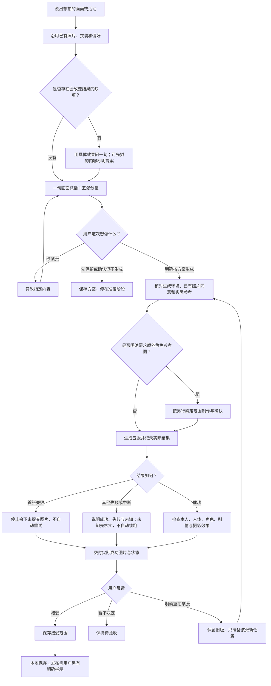

# 从用户想拍的画面开始

## 先确定本次是一套还是多系列

角色项目、主题系列、五张套图、单张镜头分开理解。默认一次拍一套，拍完问要不要接着拍；“全部拍”属试验，也可以下次继续。完整索引与返回规则见[多系列旅程](series-projects.md)，策划方法见[系列创作](series-creation.md)。下方4类能力表是每套的归类，play_mode只是内部对应。多套共同确认范围后按序调用原单套流程，不逐套重复问授权；全部不自动包含后加提案。

## 能力归类：用户不必选择分类

档位以release/CAPABILITIES.md为准。先沿用用户明确选项；多种意图同时存在时，以主要目标选一个play_mode，其他要求保存在身份、视觉、场景和摄影描述中。不因复合需求拒绝或丢掉次要目标；只有不同解释会改变结果时才用一句话澄清。

<!-- capability-table:start -->
| 类 | 子项 | 档位 | 内部对应（用户看不到） |
|---|---|---|---|
| 1 和角色同框 | 在剧组待一天 | 稳定 | classic_presence＋后台场景；user.mode=fitting（用户说只想探班/穿自己的 → traveler） |
| | 一起过日子 | 稳定 | classic_presence＋日常场景；traveler |
| | 进他的世界 | 稳定 | classic_presence＋故事世界场景；traveler；用户有任务或剧情身份 → in_story |
| | 带你去旅行（角色当导游） | 试验 | location_checkin＋角色 |
| 2 扮成一个人 | 穿戏服唱一出（中国戏曲） | 试验 | opera_costume |
| | 外国角色戏曲扮相 | 试验 | opera_costume |
| | 换上角色的衣服（试装） | 试验 | fitting；有陪同角色挂 classic_presence，否则 genre_scene |
| 3 走进一个故事 | 走进原著那一回 | 试验 | original_text；in_story |
| | 拍一部类型片 | 试验 | genre_scene；in_story |
| | 走进一部电影的场景 | 稳定 | genre_scene＋指定作品；traveler；有剧情身份 → in_story |
| | 和原创角色冒险 | 试验 | archetype；in_story |
| 4 自己去旅行 | 一个城市或几个国家 | 稳定 | location_checkin 单人 |
| 5 和宠物过日常 | 和宠物过日常小事 | 试验 | pet_daily；套图卡 pet；画面只有用户和宠物 |
<!-- capability-table:end -->

**归类顺序**（一句话按顺序判，命中即停；没命中的要求写进方案，不丢）：
1. 说了让角色带路、当导游 → 类1“带你去旅行”（试验）。
2. 点名了想陪着的角色 → 类1；去哪、做什么写进方案（“和孙悟空去巴黎”“进《西游记》见孙悟空”都在这里）。
3. 整套就是唱戏或穿某身衣服拍写真，没说去哪、没有剧情 → 类2。
4. 说了原著、某部作品、片型或原创角色 → 类3（“进某部作品的世界”没点名角色 → 某部作品）。
5. 说了自家宠物、没点名角色也没说去哪 → 类5（“拍我和我家猫的周末”）；点名了角色或地点就按那一类，宠物用可加项“带上宠物”（“带我家猫去卡帕多奇亚”→ 类4）。
6. 只说了地点 → 类4（“换上悟空的衣服逛西安”→ 类4，衣服用可加项）。
7. 都不像 → 给菜单。只有两种理解会拍出完全不同的画面时才问一句。

可加项（画风、衣服、拍几套、带上宠物）随时可说，不说就用默认；在别的类里换角色的衣服只改衣服，不换类。

例如“按西游原著拍武侠电影感”：以original_text组织依据，将武侠镜头写入cinematography；“戏曲后台化妆”：opera_costume，现代后台是场景，不另造玩法。戏曲、原著与类型电影允许有无陪同角色；只有用户说让角色带路、当导游才是角色当导游（试验），只说地点就是自己逛。“和孙悟空去巴黎”点名了角色，归类1并保留巴黎，不因内部模式删伙伴。本人照片仍限同一位主体，每套固定五张；多套可累计生成，单套任意张数超出当前实现时说明范围，不冒充法律禁止。

## 分开确定四件事

1. **身份**：traveler来访者，fitting主题试装，in_story剧情参与者。剧情身份可按用户所选角色或身份表达，不强制无名。场景是故事世界并不自动意味着扮演剧情角色。主角在故事里有任务、有角色名用in_story；只是到场看看、合影、游览用traveler。只想换上某角色或主题的衣服拍一套（如“换上飞天的衣服拍一套”）用fitting；片场、后台、化妆间等幕后套默认fitting，用户明说只想探班才用traveler（D23），不另设玩法：有陪同角色挂经典合拍，地点为主挂旅行，片场或剧情感挂类型电影。
2. **衣装妆发**：costume或outfit、hairstyle、makeup适用于各身份；按用户确认内容传递，不以一次只改一项或必须三件符号作为门槛。本人可辨与清楚露脸、陪同角色害羞仍保留。未指定妆发时沿用本人，不自行加妆。衣装选择、参考用途与穿戴阶段，以及性感、显形、裙装、高端感等诉求的落实见 scene-card.md“衣装、参考与穿戴阶段”；模式与性别不决定固定制服。
3. **视觉表现**：新方案用可选visual分别确定subject、environment和characters。值为photographic、animation_2d、animation_3d；characters省略时跟环境。style保留旧卡兼容，visual存在时优先；不按IP名字偷偷改风格。
4. **场景与拍法**：film_context/setting写现代后台、故事世界、生活场景或实地；lighting写光源；cinematography写有用的摄影选择。场景例子不是封闭菜单。

| 用户选择 | visual.subject | visual.environment | 说明 |
|---|---|---|---|
| 本人动漫化进入动漫 | animation_2d或animation_3d | 对应动画表现 | 本人也重绘 |
| 真人进入动漫画面 | photographic | animation_2d或animation_3d | 本人保持真人，环境保持动画；陪同角色按选定动画设计 |
| 真人进入真人化故事 | photographic | photographic | 整幅真实材质和电影/写真表达 |

以上是常见组合而非新白名单。旧卡仅style=anime仍采用原有日式二维表现；仅style=realistic为摄影表现。旧主题原来依赖IP特殊模板，新生成前将期望表现显式写入visual并确认，不重写历史request/案例。

## 用户实际看到的交互

没有具体想法时，可问“你想和谁同框、去哪里，或者扮成什么样？”这是开放邀请，不要求逐项回答。用户已有想法就直接概括目标并准备方案，不再展示菜单或内部英文枚举；没有想法时按dialogue.md给菜单。

- “和孙悟空在剧组待一天”：直接规划化妆、开拍、监看、收工；不问属于经典合拍还是类型电影。
- “按西游原著拍武侠电影感”：保留原著依据和武侠摄影；版本缺失先列待核并继续构思，不让用户二选一。
- “我保持真人，进入二维森林接任务”：本人和环境都已明确，不重复问画风；只有原创伙伴确实未指定时提出草案。
- “和孙悟空去巴黎”：内部以角色同框组织并保留巴黎地点，不能要求用户删掉孙悟空或改选类别。
- “我想进入纸鸢的世界”：若没有既有选择，只问“画面里的你保持真人，还是也变成动画人物？”其他已知项直接沿用；环境还存在影响结果的歧义时再给简短画面提案。
- “有什么能拍的”：按dialogue.md给菜单，允许自由说新想法；不是新的封闭菜单。用户主动问技术分类时才解释内部实现。

方案用一句画面概括加五句地点、动作和摄影目的；用户可直接说“第三张改成……”。已确认的照片、成年同意、衣装、张数与风格复用，只补真正缺项；不问内部身份、字段或分类名称。照片发送给服务、五张对应最多五次调用等实际信息在需要时简要说明，不把只准备的首句变成安装、费用和授权问卷。

只准备时保存草稿并做可用的本地校验；CLI未登录不阻断构思。用户说“分镜确认，先别生成”只确认方案；明确说“按这套生成”才进入已确定范围，已有照片同意不用重复索取。修改只影响指定内容，不追加口令。生成失败不自动重试，结果与待验收项如实反馈。

五张按具体事件推进。cover/wide/interaction/shy/ending仅内部账本槽位，不要求用户理解或按固定顺序表演；每张陪同角色保留害羞设定。无陪同角色时不凭空加人。构图建议不阻断用户已确认的同景创意。

## 电影感（所有成片默认）

所有成片默认电影级画质与电影感（Owner 2026-10-26）：像电影里的一帧，不是手机随手拍或平光广告照；编译器对每张都加这条，动画画风按动画电影画面写。电影感不等于发黄、加颗粒、压暗、加黑边：故事剧照/类型电影强调叙事，旅行也有电影布光：白天户外不压暗，靠方向光、人比背景亮、轮廓光和冷暖分离（2026-10-28），戏曲优先舞台与服饰表现。压暗的电影布光（D30）仍只按原条件加。

写入本张真正有作用的摄影选择即可，不要求每张填全参数：
- 镜头为何在这里：近景看反应，中景看交接，环境镜头说明处境；按动作选择视角，避免五张只有背景不同。
- 光从哪里来：窗、舞台灯、门外、火光或日光与人物朝向相容；脸部、道具、背景有层次，不为了气氛损害本人辨识。
- 空间怎么组织：前中后景、人物与角色的距离、视线和交接位置；浅景深服务重点，不把故事背景全糊掉。
- 动作发生了什么：每张有可读瞬间，下一张体现结果；同一空间也能有节奏。避免所有主题都“递物、举手看影子”。
- 美术与色彩：按目标选择材质、年代、服饰和环境之间的协调或有意反差，说明如何服务故事或视觉冲击；具体搭配见 scene-card.md。反差不取消现场光、透视与接触的统一；混合真人/动画时保留各自质感并协调接触阴影。

当前景别可用close_up、waist_up、knee_up、mid_interactive，以及full_body、wide（环境远景）。全身和远景更难维持本人辨识，应说明取舍并检查实际结果，不以未验证说成禁止。焦段/相机数值只是创作提案，不把它写成真实拍摄记录。

成片检查同时回答：像本人吗、陪同角色及害羞方式对吗、人体动作合理吗、本人与环境表现对吗、本张故事动作/空间和所选摄影目标实现了吗。电影感只有文案或编译通过时标“已设计，效果未验证”；旧图局部有气氛不能证明新版稳定达到目标。

## 用户旅程拓扑

技能在理解目标后自行映射内部分类、身份与视觉字段；该内部步骤不转成用户需要经过的分类页面。此图覆盖用户可见旅程，不证明真实用户可用性已验证。
